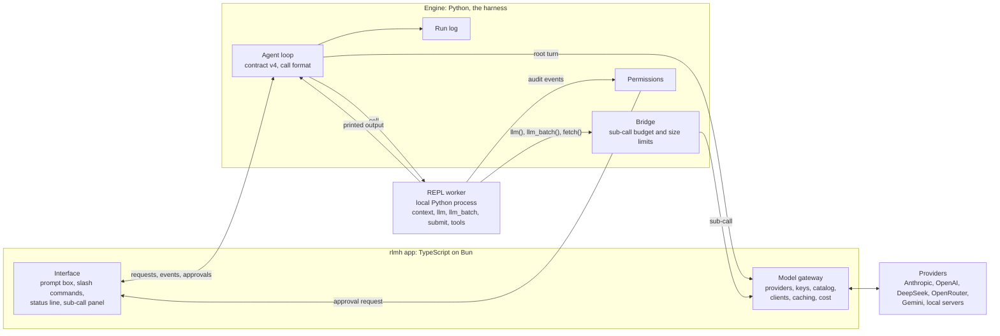

# Architecture

> Updated 2026-10-24. Decided with Rishi:
> - A thin custom build, not a fork of DeepSeek Harness (2026-10-19).
> - A TypeScript app on Bun driving a Python engine, with MCP deferred (2026-10-20).
> - No Docker and no WSL; keys entered in the app; Harness² moves up to v1 (2026-10-21).
> - Model clients move into the app; a sub-call panel with a subagent-style view; v0 gets a build plan, later versions wait (2026-10-23).
>
> The v0 spec is [v0-design.md](v0-design.md) and the steps to build it are [v0-build-plan.md](v0-build-plan.md). The research behind the choice of base is [options-research.md](options-research.md).

## What we are building

**`rlm-harness` is a full agent harness, like Claude Code or DeepSeek Harness, built around one method.** It runs any language model as a Recursive Language Model. The model never reads the long input directly. It writes Python against that input in a REPL and hands pieces of it to sub-calls (`llm`, `llm_batch`), then calls `submit` with the answer.

You install one program, `rlmh`, on macOS, Windows or Linux, paste an API key into its `/providers` screen and start working. There is no Docker, no WSL and no `.env` file to edit.

## Interface and harness

These terms come from Rishi's "Harness vs Interface" page:

- **The harness** is what the model talks to: the prompt and tool list, the call format, the code that parses and runs calls, the result text sent back, and the loop around them.
- **The interface** is what you see: screens, keys, settings, meters.
- **The test:** would the model notice if this changed? If yes, it belongs to the harness. If only you would notice, it belongs to the interface.

## The three parts

| Part | Where it runs | What it holds | Side |
|---|---|---|---|
| **Interface** | The `rlmh` app, TypeScript on Bun | The interactive terminal app: prompt box, slash commands, status line, sub-call panel, approval prompts. Also `rlmh run` and `rlmh batch` for scripts. Later a web UI and a Windows desktop app | Interface |
| **Model gateway** | Same app process | Providers, keys, the model catalog and the clients (the official `openai` SDK for every OpenAI-compatible endpoint, `@anthropic-ai/sdk` for Anthropic), cache markers, retries, in-flight limits, and usage, cost and cache-hit accounting | Interface |
| **Harness** | The engine, a Python child process of the app | The agent loop, the contract (prompt v4), the call format, the REPL worker and its tools, the sub-call bridge, permissions, the run log and profile folders | Harness |

**The gateway delivers, the engine decides.** The engine writes every byte of every request: the messages, the tool definition and the sampling settings. The gateway only turns that request into each provider's wire format and adds cache markers, neither of which the model can notice. The "Harness vs Interface" page put model clients on the harness side when they still lived in the engine. Now that they have moved, the line runs through the request: its content belongs to the harness, delivering it belongs to the gateway.

**Why the clients live in the app.** Keys never leave the program that stored them, and Python never sees one. Caching, cost and the context meter sit next to the screens that show them. Every sub-call passes through the gateway, which is what makes the sub-call panel possible without extra plumbing. And the provider code is TypeScript, where the open-source harnesses we borrow from keep theirs.

**Why the loop stays in Python.** The trained LoRA only works if it sees exactly the messages it saw in training. The training code is Python, so the engine copies it rather than rewriting it, and a replay test proves the messages match. A TypeScript loop would be a second implementation to keep in sync forever. Harness² is Python too.

**MCP is deferred.** An MCP server may come later if a real use for it shows up. Nothing in the design depends on it.

## Picture

The app and the engine talk JSON-RPC over the engine's stdin and stdout, with requests going both ways. The engine and the REPL worker talk over the worker's stdin and stdout.

## How one run works

1. **Start.** You type a question in `rlmh`. The app sends `run.start` to the engine with the question, the input (files for read mode, a folder for repo mode), the profile and the root and sub-call models you picked in `/model`.
2. **REPL.** The engine starts a fresh REPL worker, a plain Python process on your machine. The input sits in it as the variable `context` and never enters the prompt.
3. **First message.** The engine builds the system prompt from the profile and a first message: the question, the input's size and first three lines, and the turn and sub-call limits.
4. **Each turn.** The engine sends the messages to the app as a `model.complete` request for the root. The gateway calls the provider and streams the reply back. The engine takes the code from the reply, runs it in the worker, and appends what it printed, cut to 8,000 characters, followed by `(N turns left, M sub-calls left)`.
5. **Sub-calls.** Inside a cell, `llm(prompt)` and `llm_batch(prompts)` go to the engine's bridge, which checks the budget and the prompt size. The bridge sends each one to the app as a `model.complete` request for the sub-call model. Answers come back as Python strings, so the root combines them with code instead of reading them all.
6. **Approvals.** When a cell writes a file, runs a shell command or opens a network connection, the worker's audit hook asks the engine, the engine asks the app, and the app shows an approval prompt, unless the permission mode already allows it.
7. **Live view.** Throughout, the engine streams events: each reply, cell and output, each sub-call and running totals. The app draws them, and the gateway adds the streamed sub-call answers and the usage it saw.
8. **End.** The run ends when a cell calls `submit(answer)` or the turns run out. The engine sends `run.finished` and writes one line to the run log.

## Why the model makes sub-calls instead of doing the work itself

Instructions alone do not make a model delegate. The harness's structure does, in this order of strength:

1. **There is nothing else to use.** The only action is Python. There is no spawn-agent tool and no file reader outside the REPL.
2. **Doing everything itself does not fit.** The input lives in the REPL (up to about 400K characters in training). The model sees at most 8,000 printed characters a turn, with 20 turns for reading tasks and 30 for coding.
3. **Sub-calls are cheap.** About 20 run in parallel, and their answers land in variables, not in the root's context.
4. **Instructions and nudges** come last: the profile's prompt and the pacing lines.

Our step 12 training runs back this up. Where the model could manage alone, it made about 0.3 sub-calls per episode. On context search, where the input was too big to read, it made 18 to 22 and scored 0.34, against 0.00 to 0.11 without them.

**Rule for every version:** Harness² and profiles may change levers 3 and 4, never 1 and 2. The interface may show anything, but it never gives the model a way to act outside the REPL.

## Tools

The model's tools are Python functions inside the REPL:

- **From training:** `read_file`, `find_files`, `grep`, `edit_file`, `write_file`, `shell` and `diff`, as the LoRA learned them.
- **New:** `fetch(url)`, which goes through the bridge like `llm`, so the worker itself needs no network.

How the model calls them depends on the model:

- **API models** get one native tool, named `python`, whose argument is the code. Prompt v4 already accepts a `<function=python>` call, because base Qwen kept answering that way in training.
- **The LoRA and local models** write fenced `python` blocks in plain text, exactly as trained.

There are no separate native tools such as Read or Bash. They would let the model pull files straight into its prompt, which removes lever 1 above, and step 12 shows what happens then: the model stops delegating.

## Keys and providers

- **`/providers`:** pick a provider, paste the key, done.
- **Storage:** the key goes into the OS credential store through `Bun.secrets` (macOS Keychain, Windows Credential Manager, libsecret on Linux). Where that fails, it goes into an owner-only file in the config folder. Environment variables work only as an override for scripts.
- **The model list** comes from a catalog bundled with the app (context window, prices, cache prices), so a provider's models appear as soon as the key is saved. A "Refresh models" button asks the provider's `/models` endpoint, and only when you click it.
- **Hard rule: the harness never makes a call with your key that you didn't ask for.** There is no validation call when you save a key, however cheap, and no ping command. A wrong key shows up at first use with a clear message pointing back to `/providers`.
- **No subscription logins** such as Claude Pro or Max. The open-source versions of these imitate Claude Code to Anthropic's servers, which breaks Anthropic's terms.

## Caching

There is one cache, and it lives at the provider (or in vLLM or llama.cpp for local models). Neither DeepSeek Harness nor Claude Code caches responses itself. The harness's job is to make each request start with exactly the same bytes as the last one, so the provider can reuse its work:

- **Append-only history.** Nothing earlier in a run's messages is ever edited or reordered.
- **Byte-stable prefix.** The system prompt and tool definition never change during a run, and anything that changes goes last. The `(N turns left, M sub-calls left)` suffix already sits at the end of each observation.
- **Anthropic:** cache breakpoints at the end of the system prompt and on the latest message.
- **`llm_batch`:** the gateway finds the longest prefix the batch's prompts share. When it reaches the model's minimum cacheable length (512 to 4,096 tokens, depending on the model), the gateway marks it, sends the first call, waits for that call's first token and then sends the rest, because an Anthropic cache entry is readable only once the first response has started.
- **OpenAI:** `prompt_cache_key` set to the run id. **OpenRouter:** `session_id` set to the run id. **DeepSeek** caches automatically.
- **Visible:** the status line shows the cache hit rate, so a broken prefix is noticed.

RLM already helps here: the long input lives in the REPL, so it is never in the prompt at all.

## Safety without Docker

Training ran the REPL in a Docker container with no network, because it had to stop reward hacking. A tool on your own machine has a different job: stop accidents, and ask before anything risky.

- **Audit hooks.** The worker installs Python audit hooks (PEP 578) before any model code runs. They see opening a file for writing outside the workspace, starting a process (`subprocess.Popen`, `os.system`) and opening a network connection (`socket.connect`).
- **Approval.** Each such event pauses the cell and sends an approval request through the engine to the app, which shows the prompt. A "no" reaches the model as an error in the cell's output.
- **Modes:** `default` asks for writes, shell commands and network; `accept-edits` lets writes inside the workspace through without asking; `bypass` asks for nothing.
- **What this is not.** Like Claude Code's permission prompts, this stops accidents, not a determined attacker: code can get around audit hooks. An optional OS sandbox (Seatbelt on macOS, bubblewrap or Landlock on Linux) can come later.

## Platforms and install

- **Native on macOS, Windows and Linux.** No Docker, no WSL.
- **One command to install.** `install.sh` or `install.ps1` downloads one compiled `rlmh` binary (`bun build --compile`) from GitHub Releases.
- **Python comes from uv on first run.** The engine needs Python 3.12 and nothing else, because it uses only the standard library now that the model clients live in the app.

## Relationship to the RLM training repo

The training environment in [RishiJain905/RLM](https://github.com/RishiJain905/RLM) (`rlm_rl/`) is already an RLM harness for one model. The engine copies its contract rather than importing it.

- **Copied:**
  - `bridge.py`: prompt v4, limits, observation and error text, code extraction.
  - `repl_worker.py`: the REPL process and its audit hooks.
  - `repl_tools.py`: the seven coding tools.
  - The loop from `env.py:run_episode`.
- **Left behind:** token ids and prompt logprobs, reward, hack detectors, the edit grader, ART and W&B.
- **Changed:**
  - The Docker sandbox becomes a local worker with permission prompts.
  - The Unix-socket bridge moves onto the worker's stdio.
  - The model client moves into the app.
- **Kept in step:**
  - A test checks that our copy of prompt v4 hashes to the training repo's `PROMPT_HASHES["v4"]`.
  - A parity script replays recorded training episodes through the engine with a fake app standing in for the models, and checks that the engine sends the same messages. The trained LoRA then sees exactly what it saw in training.

Task data, gold answers and transcripts stay in the RLM repo and on the training PC. This repo holds none of them. Evaluations with gold answers run from a script in the RLM repo through `rlmh batch --json`.

## What we borrow

Both open-source harnesses below are MIT-licensed, so we can reuse code as well as ideas, keeping their notices.

**OMP** ([can1357/oh-my-pi](https://github.com/can1357/oh-my-pi)):
- Take:
  - its bundled model catalog
  - the `/login`-style provider list
  - model roles (they map straight onto our root and sub-call models)
  - one settings schema that drives both the screen and the command line
  - status-line segments
  - the `/context` grid
  - sessions
- Leave:
  - key validation on entry (it checks 47 of its 60 providers that way)
  - its Anthropic OAuth login
  - depending on its packages (they need a prebuilt Rust binary and release almost daily)
  - its extras: LSP, browser control, voice, memory banks and the marketplace

**DeepSeek Harness** ([deepseek-ai/deepseek-harness](https://github.com/deepseek-ai/deepseek-harness)):
- Take:
  - a "KV cache effect" note at the top of every module, saying whether it can change the bytes sent to the model
  - the append-only log
  - its compaction rule, which compacts at min(0.8W, W − output − 65,536) tokens and keeps the newest 16% (rarely needed in RLM)
  - the context ring and the cache-hit pill
  - checking only a key's format
  - the local web UI pattern for v2

**Claude Code** (behaviour only, it is not open source): permission modes, `/context`, `/usage`, and compaction as a fork that keeps the same prefix.

## Versions

| Version | Adds | Done when |
|---|---|---|
| **v0** | The engine, the gateway and the interactive `rlmh` app, natively on three OSes, with read mode and repo mode, the sub-call panel and a one-command install | The parity script passes and a smoke run works on two models from `rlmh` |
| **v1** | Harness² and the experiment: the base model on the default profile vs a Harness²-tuned profile vs the trained LoRA, on about 20 held-out context-search tasks. Harness² reaches users three ways: a pre-tuned default profile, a cheap experience memory, and an opt-in `/tune` that shows a cost estimate before it starts (about 4 runs per task). Also `rlm()` recursion with a depth limit (off for the LoRA, which never saw it), which turns a sub-call into a nested run with its own turns: a true sub-agent view | One A/B round on the held-out tasks |
| **v2** | Full TUI polish and a local web UI in the style of DeepSeek Harness | A run can be started, watched and reopened from the web UI |
| **v3** | The Windows desktop app and the public release. For users this is version 1 | A fresh Windows PC installs it and completes a run |
| **Later** | An MCP server, if a real use appears | |

Only v0 has build steps so far. Each later version gets its steps once the one before it is done.
