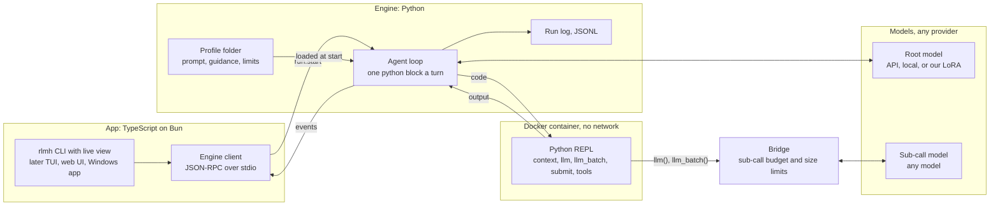

# Architecture

> Updated 2026-10-20. Decided with Rishi: a thin custom build, not a fork of DeepSeek Harness (2026-10-19); a TypeScript app on Bun driving a Python engine, with MCP deferred (2026-10-20). Research behind the choices: [options-research.md](options-research.md).

## What we are building

**`rlm-harness` is a full agent harness, like Claude Code or DeepSeek Harness, built around one method.** It runs any language model as a Recursive Language Model: the model never reads the long input directly. Instead, it writes Python against that input in a sandboxed REPL and hands pieces of it to sub-calls. You use it from a terminal now and from a desktop app later.

It has two halves:

| Half | Language | What it holds | Why this language |
|---|---|---|---|
| **App** | TypeScript on Bun | The `rlmh` CLI with a live view of each run; later a TUI, a local web UI and a Windows desktop app | The UI is where TypeScript is strongest, and it is what DeepSeek Harness and Claude Code are built in |
| **Engine** | Python | The agent loop, the RLM contract (prompt v4), the Docker sandbox, the sub-call bridge, the model clients and the run log | The training code is Python, so the trained LoRA's contract is copied rather than rewritten. Harness² is Python too |

The app never decides what the model sees. It starts runs, shows them and stores nothing but settings. Everything the root model reads is written by the engine.

**Why the loop lives in Python.** The trained LoRA only works if it sees exactly the messages it saw in training. Keeping the loop in the same language as the training code means the copy can be checked line for line, and a replay test can prove the messages match. A TypeScript loop would be a second implementation to keep in sync forever.

**MCP is deferred.** An MCP server that lets Claude Code or DeepSeek Harness hand a job to this harness may come later, if a real use for it shows up. Nothing in the design depends on it.

## Picture

## How one run works

1. **Start.** You type `rlmh run` with a question and a file (or a repo). The app starts the engine and sends `run.start` with the question, the input's path, the root and sub-call model names and the profile.
2. **Sandbox.** The engine starts a fresh Docker container with no network. The input sits in the container as the variable `context` and never enters the prompt.
3. **First message.** The root model gets the system prompt from the profile and a first message: the question, the input's size and first three lines, and the turn and sub-call limits.
4. **Each turn.** The root replies with a short plan and one fenced `python` block. The engine runs the block in the REPL and sends back what it printed, cut to 8,000 characters, followed by `(N turns left, M sub-calls left)`.
5. **Sub-calls.** Inside the block, `llm(prompt)` and `llm_batch(prompts)` reach the host through the bridge, which checks the budget and prompt size and then calls the sub-call model. Answers come back as Python strings, so the root combines them with code instead of reading them all.
6. **Live view.** As it goes, the engine streams events to the app: each reply, each cell and its output, each sub-call, and running token and cost totals. The app draws them.
7. **End.** The run ends when a cell calls `submit(answer)` or the turn limit is reached. The engine sends `run.finished` with the answer and writes one line to the run log.

**Keys stay on your machine.** `models.toml` names each model's endpoint and the environment variable that holds its key. The engine reads the key from your environment when it calls the model. Keys are never written to disk by the harness, never sent to the app's UI, and never reach the container, which can only talk to the bridge.

## Why the model makes sub-calls instead of doing the work itself

Instructions alone do not make a model delegate. The harness's structure does, in this order of strength:

1. **There is nothing else to use.** The only action is a Python block. There is no spawn-agent tool and no file reader outside the REPL.
2. **Doing everything itself does not fit.** The input lives in the REPL (up to about 400K characters). The model sees at most 8,000 printed characters a turn, with 20 turns for reading tasks and 30 for coding.
3. **Sub-calls are cheap.** About 20 run in parallel, and their answers land in variables, not in the root's context.
4. **Instructions and nudges** come last: the profile's prompt and the pacing lines.

Our step 12 runs back this up. Where the model could manage alone, it made about 0.3 sub-calls per episode. Where the input was too big to read, it made 18 to 22 and scored 0.34 against 0.00 to 0.11 without them. **Rule for every later version:** Harness² and profiles may change items 3 and 4, never items 1 and 2. The app may show anything, but it never adds a way for the model to act outside the REPL.

## Platforms

- **v0 runs where training runs:** Linux, or Windows through WSL2, with Docker. The bridge uses a Unix socket into the container, as in training.
- **On Windows the app runs natively** and starts the engine inside WSL (`wsl -d Ubuntu -- …`), so the terminal you use is ordinary PowerShell or Windows Terminal.
- **Before the Windows desktop app (v3)** the bridge moves from the Unix socket onto the container's stdio. Then the engine can run natively on Windows with Docker Desktop, and WSL is no longer needed. The wire protocol stays the same, so the model sees no difference.

## Relationship to the RLM training repo

The training environment in [RishiJain905/RLM](https://github.com/RishiJain905/RLM) (`rlm_rl/`) is already an RLM harness for one model. The engine copies its contract and sandbox rather than importing them:

- **Copied:** `bridge.py` (prompt text v4, limits, observation text, wire protocol), `repl_worker.py`, `repl_tools.py`, `sandbox.py`, and the loop from `env.py:run_episode`.
- **Left behind:** training-only parts, namely token ids and prompt logprobs, reward, hack detectors, the edit grader, ART and W&B.
- **Kept in step:** a test checks that our copy of prompt v4 hashes to the same value as the training repo's `PROMPT_HASHES["v4"]`. A parity script replays recorded training episodes and checks that the engine produces the same messages. The trained LoRA then sees exactly what it saw in training.

Task data, gold answers and transcripts stay in the RLM repo and on the training PC. This repo holds no task data. Evaluations with gold answers run from a script in the RLM repo that drives the engine.

## Versions

| Version | Adds | Done when |
|---|---|---|
| **v0** | The engine in read mode (v0a), then repo mode with coding tools (v0b). The Bun app: `rlmh run`, `rlmh batch` and `rlmh models`, with a live view of each run | The parity script passes and a smoke run works on two models from `rlmh` |
| **v1** | A full-screen TUI; a local web UI (`rlmh web`) in the style of DeepSeek Harness, with past runs browsable from the run log; optional `rlm()` recursion with a depth limit (off for the LoRA, which never saw it); a native Anthropic client for prompt caching | A run can be started, watched and reopened from the web UI |
| **v2** | Harness² plug-in ("substrate") and the experiment: base model on the default profile vs a Harness²-tuned profile vs the trained LoRA | One A/B round on about 20 held-out context-search tasks |
| **v3** | Windows desktop app and installer, wrapping the v1 web UI; the bridge on container stdio so no WSL is needed | A fresh Windows machine with Docker Desktop installs it and completes a run |
| **Later** | An MCP server, if a real use for it appears | |

Details of v0: [v0-design.md](v0-design.md).
