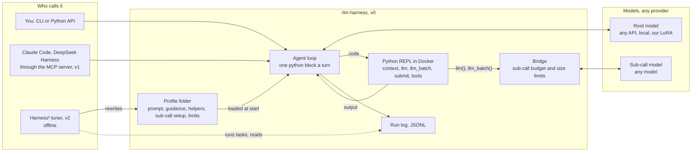

# Architecture

> Written 2026-10-20. Decided with Rishi on 2026-10-19: a thin custom build in Python, not a fork of DeepSeek Harness. Research behind the choice: [options-research.md](options-research.md).

## What we are building

**`rlm-harness` is a full agent harness.** It runs any language model as a Recursive Language Model: the model never reads the long input directly. Instead, it writes Python against that input in a sandboxed REPL and hands pieces of it to sub-calls. You run it yourself from the command line or from Python. Everything else in this document is either a door into it or a tool that tunes it.

| Part | What it is | When it runs | Version |
|---|---|---|---|
| **The harness** | A Python package and CLI: agent loop, Docker REPL, sub-call bridge, model clients, run log | Every time anyone uses RLM | v0 |
| **MCP server** | One small file that exposes `rlm_run` as a tool, so another agent can hand the harness a job | Only when Claude Code, DeepSeek Harness or another agent calls it | v1 |
| **Harness² tuner** | Google's released Harness² code plus a small plug-in for our harness. It runs the harness on tasks and rewrites the harness's profile folder | Offline, when we choose to tune a profile. Never during normal use | v2 |

The MCP server and Harness² never change how a run works inside the harness. The MCP server is just another caller, like the CLI. Harness² only changes the text and helper files in a profile folder, which the harness reads at start.

## Picture

## How one run works

1. **Start.** The caller passes a question, the long input (`context`), a root model, a sub-call model and a profile. The harness starts a fresh Docker container with no network. The input sits in the container as the variable `context` and never enters the prompt.
2. **First message.** The root model gets the system prompt from the profile and a first message. That message gives the question, the input's size and its first three lines, and the turn and sub-call limits.
3. **Each turn.** The root model replies with a short plan and one fenced `python` block. The harness runs the block in the REPL and sends back what it printed, cut to 8,000 characters, followed by `(N turns left, M sub-calls left)`.
4. **Sub-calls.** Inside the block, `llm(prompt)` and `llm_batch(prompts)` reach the host through a Unix socket. The bridge checks the budget and prompt size, then calls the sub-call model. Answers come back as Python strings, so the root combines them with code instead of reading them all.
5. **End.** The run ends when a cell calls `submit(answer)` or the turn limit is reached. The run log records every turn, cell, sub-call, token count and cost.

API keys stay on the host. The container can reach only the bridge socket.

## Why the model makes sub-calls instead of doing the work itself

Instructions alone do not make a model delegate. The harness's structure does, in this order of strength:

1. **There is nothing else to use.** The only action is a Python block. There is no spawn-agent tool and no file reader outside the REPL.
2. **Doing everything itself does not fit.** The input lives in the REPL (up to about 400K characters). The model sees at most 8,000 printed characters a turn, with 20 turns for reading tasks and 30 for coding.
3. **Sub-calls are cheap.** About 20 run in parallel, and their answers land in variables, not in the root's context.
4. **Instructions and nudges** come last: the profile's prompt and the harness's pacing lines.

Our step 12 runs back this up. Where the model could manage alone, it made about 0.3 sub-calls per episode. Where the input was too big to read, it made 18 to 22 and scored 0.34 against 0.00 to 0.11 without them. **Rule for every later version:** Harness² and profiles may change items 3 and 4, never items 1 and 2.

## Relationship to the RLM training repo

The training environment in [RishiJain905/RLM](https://github.com/RishiJain905/RLM) (`rlm_rl/`) is already an RLM harness for one model. v0 copies its contract and sandbox rather than importing them:

- **Copied:** `bridge.py` (prompt text v4, limits, observation text, wire protocol), `repl_worker.py`, `repl_tools.py`, `sandbox.py`, and the loop from `env.py:run_episode`.
- **Left behind:** training-only parts, namely token ids and prompt logprobs, reward, hack detectors, the edit grader, ART and W&B.
- **Kept in step:** a test checks that our copy of prompt v4 hashes to the same value as the training repo's `PROMPT_HASHES["v4"]`. A parity test replays a recorded training episode and checks that the harness produces the same messages. The trained LoRA then sees exactly what it saw in training.

Task data, gold answers and transcripts stay in the RLM repo and on the training PC. This repo holds no task data. Evaluations with gold answers run from a script in the RLM repo that imports this package.

## Versions

| Version | Adds | Done when |
|---|---|---|
| **v0** | The harness: read mode first (v0a), then repo mode with coding tools (v0b). CLI, Python API, model config, run log | The parity test passes and a smoke run works on two models |
| **v1** | MCP server; optional `rlm()` recursion with a depth limit (off for the LoRA, which never saw it); native Anthropic client for prompt caching | Claude Code can call `rlm_run` and get an answer |
| **v2** | Harness² plug-in ("substrate") and the experiment: base model on the default profile vs a Harness²-tuned profile vs the trained LoRA | One A/B round on about 20 held-out context-search tasks |

Details of v0: [v0-design.md](v0-design.md).
