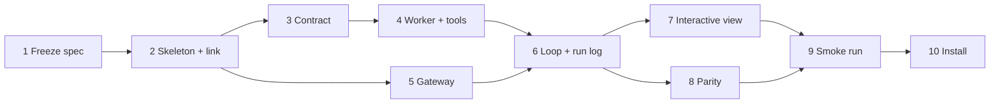

# v0 build docs

This folder lets a thread pick up one v0 step and build it without asking anyone. It covers only the ten v0 steps; in the roadmap, v1 is the Harness² release.

## How a thread uses it

1. Read this README, then [architecture.md](architecture.md), which pins every shared path, message and signature, then [decisions.md](decisions.md).
2. Read your spec in [specs/](specs/), and the parent-doc sections it lists under "Read first".
3. Check [progress.md](progress.md): every step yours depends on must be `done`. Then set your row to `in progress`, with your thread's name.
4. Build exactly what the spec lists, and run its tests.
5. Update your row and the log in progress.md. If you had to change a shared interface, change architecture.md too and say so in the log.

When a spec is silent, follow architecture.md. When architecture.md is silent, follow [../v0-design.md](../v0-design.md). If you must make a new call, add it to decisions.md as the next D-number.

## The steps

| # | Spec | Type |
|---|---|---|
| 1 | [Freeze the v0 spec](specs/step-01-freeze-spec.md) | Design |
| 2 | [Skeleton, the stdio link both ways, CI and a binary per OS](specs/step-02-skeleton-link.md) | PC |
| 3 | [Contract: prompt v4, hash test, both call formats](specs/step-03-contract.md) | PC |
| 4 | [Native REPL worker, tools and permissions](specs/step-04-worker-tools-permissions.md) | PC |
| 5 | [Model gateway](specs/step-05-gateway.md) | PC |
| 6 | [Loop, events and run log; `rlmh run` and `--json`](specs/step-06-loop-runlog-cli.md) | PC |
| 7 | [Interactive view](specs/step-07-interactive-view.md) | PC |
| 8 | [Parity with training](specs/step-08-parity.md) (script in the RLM repo) | PC |
| 9 | [Smoke run](specs/step-09-smoke-run.md) (script in the RLM repo) | Spend |
| 10 | [One-command install](specs/step-10-install.md) | PC |

**In parallel:** step 5 runs alongside steps 3 and 4, and step 7 alongside step 8. Everything else is in sequence.

## Parent docs

- [../architecture.md](../architecture.md): the three parts, why the model delegates, caching, safety and the roadmap.
- [../v0-design.md](../v0-design.md): the v0 spec.
- [../v0-build-plan.md](../v0-build-plan.md): the ten steps and their decisions.
- [The blueprint page](https://claude.ai/artifact/ANEF1LJnj42r5Mo9JywxqU).

## Repo rules

- **This repo is public.** Never commit keys, transcripts, gold answers or task data. Parity and smoke inputs stay in the RLM repo and on Rishi's PC.
- **Prompt v4 is frozen.** Never edit its text. `test_contract` pins its hash.
- **Never make a call with a user's key that they didn't ask for.** That means no validation calls and no pings, and every test runs offline against fakes.
- **Never commit or push without Rishi's say-so.**
- Step 9 spends Rishi's own API keys, and only after he has seen the estimate and said go. Nothing here ever uses W&B credit.
