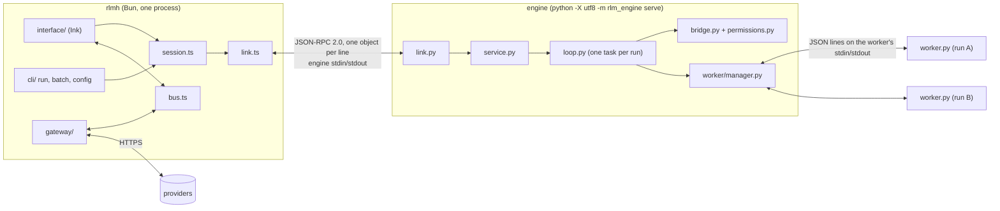

# v0 build architecture

> Written 2026-10-28 for the threads that build v0. The why is in [../legacy/architecture.md](../legacy/architecture.md), the spec in [../legacy/v0-design.md](../legacy/v0-design.md) and the steps in [../legacy/v0-build-plan.md](../legacy/v0-build-plan.md). This file pins the names, paths, messages and signatures those docs leave to the builder, so threads working in parallel stay compatible. Calls made here are listed in [decisions.md](decisions.md) as D-numbers. If this file and a parent doc disagree, the parent doc wins and this file gets fixed.

## 1. The three parts and the processes

The parts are described in [../legacy/architecture.md § The three parts](../legacy/architecture.md#the-three-parts). As processes:



- **One app process.** It holds the interface, the CLI commands and the gateway. `session.ts` owns one engine child and wires the link, the gateway and the bus together.
- **One engine process per app.** It is a child of the app, and it holds every run the app starts: one interactive run at a time, or N with `rlmh batch --jobs N`. Its stdout carries only protocol, and its logs go to stderr. When its stdin closes, it cancels every run, kills the workers and exits.
- **One worker process per run.** It is a child of the engine, started fresh for each run and again after each timeout or crash. It is launched as `python -I -B -X utf8 <engine dir>/rlm_engine/worker/worker.py` (D-01, D-42). It speaks JSON lines on its own stdin and stdout, and puts its diagnostics on stderr, which the engine copies to its own stderr.
- **Environment.**
  - The app starts the engine with its own environment, minus key-like variables (names matching `KEY|TOKEN|SECRET|PASSWORD|CREDENTIAL|AUTH`, any case) and git's whole `GIT_CONFIG_COUNT`/`GIT_CONFIG_KEY_<n>`/`GIT_CONFIG_VALUE_<n>` set (D-62), plus `RLMH_HOME=<home>`, `PYTHONUTF8=1` and `PYTHONUNBUFFERED=1`. Variables such as `SYSTEMROOT` stay, because Python on Windows needs them.
  - The engine learns its home only from `RLMH_HOME` (D-49).
  - It strips key-like variables and git's env config again for the worker, and sets `TMPDIR`, `TEMP` and `TMP` to the run's scratch folder (D-29, D-62).

## 2. Repo layout

Each file has the step that creates it. A later step that changes a file is shown after a `+`. Files not in [v0-design.md § Layout](../legacy/v0-design.md#layout) are marked ◆ (D-03).

```
rlm-harness/
  .github/workflows/ci.yml           2 +10   test + build on macos/windows/ubuntu
  .github/workflows/release.yml      10      binaries to GitHub Releases on a tag
  .gitignore                         exists  +2 adds *.bun-build, *.tsbuildinfo; .bun/ stays in .git/info/exclude
  .gitattributes                     exists  +2 ◆ adds * text=auto eol=lf, so hashes and profiles match on every OS (D-43); keeps scripts/*.sh LF
  scripts/verify.ps1, verify.sh      exists  the verify gate (see CLAUDE.md); gains stages as engine/ and app/ land
  protocol/examples.json             2 ◆     one example of every method, result, error and event (D-02)
  install.sh, install.ps1            10
  app/
    package.json                     2       name rlm-harness, bin rlmh, packageManager bun@1.4.4
    bun.lock, tsconfig.json          2
    src/
      main.ts                        2 +6 +7 +10  argv dispatch (§10)
      version.ts                     2 ◆     APP_VERSION, PROTOCOL_VERSION = 1
      paths.ts                       2 ◆     home(), runsDir(), profilesDir(), … (§9)
      protocol.ts                    2 ◆     TS types for §4-§6, error codes
      link.ts                        2       JSON-RPC peer over a pair of streams
      engine.ts                      2 +10   finds and starts the engine (§7.1)
      bus.ts                         2 ◆     typed in-process event bus (§7.3)
      settings.ts                    2 +5    the one schema (§8), load and save settings.toml
      session.ts                     6 ◆     engine + gateway + bus + approvals for one app
      cli/run.ts, cli/batch.ts       6 ◆     rlmh run, rlmh batch
      cli/config.ts                  6 ◆     rlmh config get|set|list
      cli/print.ts                   6 ◆     the plain view and the --json line writer
      cli/setup.ts                   10 ◆    first-run Python and engine install
      interface/App.tsx              2 +7    empty screen in step 2; the real app in step 7
      interface/*.tsx                7       PromptBox, Transcript, StatusLine, SubcallPanel,
                                             SubcallView, Approval, commands/*.tsx
      interface/*.ts                 7 ◆     private helpers (store, format, mentions, approvals, runs,
                                             commands/index); only .tsx files import Ink
      gateway/gateway.ts             5 ◆     Gateway: model.complete, caps, retries, window check
      gateway/providers.ts           5
      gateway/keys.ts                5
      gateway/catalog.ts             5
      gateway/openai.ts              5
      gateway/anthropic.ts           5
      gateway/fake.ts                5 ◆     the scripted fake provider (§7.5)
      gateway/cache.ts               5
      gateway/usage.ts               5
      gateway/stream.ts              5 ◆     what openai.ts and anthropic.ts share with gateway.ts: hooks, results, AttemptError
    catalog/models.json              5
    catalog/ATTRIBUTION.md           5 ◆
    scripts/build-catalog.ts         5 ◆     builds models.json from OMP's catalog
    scripts/embed-engine.ts          10 ◆    writes build/engine-files.ts, the engine files the binary embeds
    build/engine-files.ts            10      generated and git-ignored (build/)
    test/                            2 5 6 7 10 (§11)
  engine/
    pyproject.toml, uv.lock          2       requires-python ==3.12.*, no dependencies, dev group: pytest
    rlm_engine/
      __init__.py                    2       __version__
      __main__.py                    2       `serve`: builds Link + Engine, runs until stdin closes
      errors.py                      2 ◆     InfraError, SubcallError, ModelError
      link.py                        2       JSON-RPC peer
      appport.py                     2 ◆     AppPort protocol + LinkAppPort (§7.2)
      service.py                     2 +3 +6 ◆  Engine: engine.info (2; contract fields 3), run.* (6)
      contract.py                    3       copy of bridge.py v4 + env.extract_code
      callformat.py                  3
      profiles.py                    3 ◆     load and hash profiles
      profiles/training-v4/profile.toml        3
      profiles/default/profile.toml, guidance.md 3
      workspace.py                   4 ◆     git snapshot, fingerprint, shell lookup
      permissions.py                 4
      bridge.py                      4
      worker/__init__.py             4       empty
      worker/manager.py              4
      worker/worker.py               4       copy of repl_worker.py, native
      worker/hooks.py                4
      worker/tools.py                4       copy of repl_tools.py + fetch
      inputs.py                      6 ◆     read-mode context, repo listing, language, test hint
      loop.py                        6
      runlog.py                      6
    tests/                           2 3 4 6 (§11)
  documentation/v0/                  1
```

## 3. The link

- **Framing.** JSON-RPC 2.0, one UTF-8 JSON object per line terminated by `\n`, no batches. Lines may be long: a `run.start` result is small, but `model.complete` params carry the whole conversation.
- **Ids.** The app numbers its requests with integers from 1, and the engine with strings `"e1"`, `"e2"`, …. A message with `result` or `error` and no `method` answers one of the receiver's own requests.
- **Notifications** have no `id` and get no answer. All engine events are notifications, and so is `model.cancel`.
- **Version.** `PROTOCOL_VERSION = 1` in `version.ts` and `rlm_engine/__init__.py`. `engine.info` returns it, and the app refuses to run against a different one.
- **Concurrency.** Both sides handle requests concurrently. A slow `model.complete` never blocks a `run.cancel`.
- **Engine stdin** is read on a thread that hands each line to the asyncio loop, because asyncio pipe reading isn't reliable on Windows (D-30).

- **Line limit.** A line over `MAX_LINE_BYTES` (32 MiB) is answered with -32600, `id: null`, and the link stays open.

**Error codes.** `link.py` exports these names as constants, and `protocol.ts` as the `ErrorCode` object:

| Code | Name | Used for |
|---|---|---|
| -32700, -32600, -32601, -32602, -32603 | `PARSE_ERROR`, `INVALID_REQUEST`, `METHOD_NOT_FOUND`, `INVALID_PARAMS`, `INTERNAL_ERROR` | parse error, invalid request, unknown method, bad params, internal |
| -32001 | `MODEL_ERROR` | `model.complete` failed; `data` is a ModelErrorData |
| -32010 | `UNKNOWN_RUN` | `run.cancel` or `run.vars` for a run that doesn't exist or has finished |
| -32011 | `UNKNOWN_PROFILE` | `run.start` names no known profile |
| -32012 | `BAD_INPUT` | missing input file, a repo path that isn't a folder, or a missing field |
| -32800 | `CANCELLED` | the request was cancelled (a run was cancelled, or the app is closing) |

## 4. Shared types

These are JSON shapes. `protocol.ts` holds them as TypeScript types, and the engine works on plain dicts with these keys.

| Type | Shape |
|---|---|
| **ModelRef** | `{provider: string, model: string, thinking: "off"\|"low"\|"medium"\|"high"\|null}`. `null` means the profile's default (D-08). The engine never looks inside it, except to record it |
| **Message** | `{role:"system", content}` · `{role:"user", content}` · `{role:"assistant", content, tool_call?: ToolCall}` · `{role:"tool", tool_call_id, content}`. `content` is always a string, and an assistant message carries at most one tool call (D-04) |
| **ToolCall** | `{id: string, name: string, arguments: object}`. For the `python` tool, `arguments` is `{code: string}` |
| **ToolDef** | `{name, description, parameters}`, where `parameters` is a JSON Schema. v0 has exactly one: `PYTHON_TOOL` (§6.2) |
| **Usage** | `{input_tokens, output_tokens, cache_read_tokens, cache_write_tokens, reasoning_tokens, cost_usd}`. `input_tokens` counts all prompt tokens, cached ones included; cache reads and writes are subsets of it (D-22) |
| **ModelErrorData** | `{kind, provider, model, status: int\|null, message}`, where `kind` is one of `auth`, `no_key`, `bad_request`, `rate_limit`, `server`, `timeout`, `network`, `context_window`, `unknown_model`, `cancelled`, `other` |
| **Origin** | `{turn: int, line: int\|null}`: the root turn and the line in that turn's cell |
| **Batch** | `{id: string, index: int, size: int}`. A single `llm()` call is a batch of one (D-24) |

## 5. Methods

### 5.1 App → engine

| Method | Params | Result | Errors |
|---|---|---|---|
| `engine.info` | `{}` | `{version, protocol, python, contract, contract_hash, training_hash, profiles: [{name, source: "builtin"\|"user", prompt_hash, profile_hash}]}`. `contract*` and `profiles` were `null` and `[]` in step 2; since step 3 `contract` is `"v4"` and `profiles` lists the built-ins, then user profiles, each sorted by name | |
| `run.start` | the run.start table below | `{run_id, log_path}`, returned once the worker is ready and before the first root call. `run_id` is `"r_"` plus 12 lowercase hex characters (D-38) | -32011, -32012 |
| `run.cancel` | `{run_id}` | `{}`. The run finishes with `infra_error = "cancelled"` and `infra_kind = "cancelled"` | -32010 |
| `run.vars` | `{run_id}` | `{vars: [{name, type, len: int\|null, chars: int}]}`: user-made globals only, with `chars = len(repr(v))` capped at 10⁶ | -32010 |
| `debug.roundtrip` | `{count}` | `{texts: string[]}`. The engine sends `count` concurrent `model.complete` requests (`run_id: "debug"`, `role: "root"`, messages `[{role: "user", content: "ping <i>"}]`) and returns the answers in order. Registered only when `RLMH_DEBUG=1`; it exists for the link tests (step 2) | |

**`run.start` params:**

| Param | Type | Needed | Meaning |
|---|---|---|---|
| `mode` | `"read"\|"repo"` | always | |
| `question` | string | read | |
| `inputs` | string[] | read, at least 1 | absolute paths; `context` is built from them (§6.3) |
| `task` | string | repo | |
| `repo_path` | string | repo | absolute path to a folder; a git repo is needed for `diff()` |
| `test_hint`, `language`, `n_files`, `context` | string, string, int, string | optional, repo | override what `inputs.py` detects; parity and the RLM evaluations use them (D-07) |
| `profile` | string | always | e.g. `training-v4`, `default` |
| `root`, `sub` | ModelRef | always | |
| `permission_mode` | `"default"\|"accept-edits"\|"bypass"` | always | |
| `call_format` | `"fenced"\|"native"` | always | already resolved by the app (§7.4, D-07) |
| `interactive` | bool | optional, default `false` | `true` when someone can answer approvals; otherwise anything that would ask is denied (D-15) |
| `tag` | string | optional | echoed in `run.started`, `run.finished` and the run log; `rlmh batch` puts the task id here |
| `batch` | string | optional, default `"interactive"` | the run-log folder name (§9) |
| `log_dir` | string | optional | absolute folder for `runs.jsonl`; wins over `batch` |

### 5.2 Engine → app

| Method | Params | Result |
|---|---|---|
| `model.complete` | `{run_id, role: "root"\|"sub", model: ModelRef, messages: Message[], tools: ToolDef[], max_tokens, temperature, thinking: "off"\|"low"\|"medium"\|"high", turn}`, and for sub-calls also `{subcall_id: int, origin: Origin, batch: Batch}` | `{text, tool_call: ToolCall\|null, reasoning: string\|null, usage: Usage, finish_reason: "stop"\|"length"\|"tool_call"\|"content_filter"\|"other", served_model: string, seconds}`, or error -32001 |
| `approval.request` | `{run_id, kind: "write"\|"shell"\|"network", detail, turn, inside_workspace}` | `{allow: bool, remember_for_run: bool}` |

- **`thinking` is resolved by the engine:** the ref's value, else the profile's `subcall_thinking` for sub-calls, else `"off"` (D-08).
- **A sub-call's `messages`** is exactly `[{role: "user", content: prompt}]`, with `tools: []`, as in training (`client.subcaller`).
- **A root call's `tools`** is `[PYTHON_TOOL]` in native format and `[]` in fenced format.

### 5.3 Events: engine → app notifications

Every event carries `run_id`. Turns are numbered from 1. `tag` is `null` when `run.start` had none, and `run.subcall.seconds` is `null` at `sent` (D-55).

| Method | Params besides `run_id` | Sent |
|---|---|---|
| `run.started` | `tag, mode, profile, prompt_hash, profile_hash, contract_hash, call_format, root, sub, permission_mode, workspace, input: {chars, lines, sha256, files}, limits: {max_turns, max_subcalls, root_max_tokens, output_max_chars, cell_timeout_s, subcall_max_chars, subcall_max_tokens}, log_path` | once, before the first root call. `input` is defined as training defined it: `chars = len(context)`, `lines = len(context.splitlines())`, `sha256` = hex of `sha256(context.encode("utf-8", "replace"))`. `files` is the list of input paths as given, with `/` separators, in read mode, and `[]` in repo mode |
| `run.reply` | `turn, text, tool_call, reasoning, finish_reason, usage, seconds` | after each root reply |
| `run.cell` | `turn, code (null when the reply had none), output (stdout as the model sees it, truncation note included), error, observation (the next message's text, or null after a submit or the last turn), seconds (compute), restarted, crash, repo_changed` | after each cell, or after the no-code error |
| `run.subcall` | `subcall_id, origin, batch, prompt_chars, status: "sent"\|"done"\|"error"\|"rejected", error, seconds` | sent by the bridge at `sent` and again at the end. A budget or oversize refusal is one `rejected` event, with `subcall_id: null` and `prompt_chars` set to the longest prompt |
| `run.permission` | `turn, kind, detail, allowed, asked, remembered` | sent by `Permissions` for each decision on a guarded action, except writes inside the scratch folder; at most 200 per run |
| `run.budget` | `turns_left, subcalls_left` | sent by the loop after each turn and by the bridge after each batch |
| `run.finished` | `tag, answer, submitted, answer_valid, turns, subcalls, usage: {root: Usage, sub: Usage}, cost_usd, infra_error, infra_kind, wall_s, log_path` | once, after the run-log line is written |
| `model.cancel` | (only `run_id`) | when a run is cancelled or ends with calls still in flight; the gateway aborts them |

### 5.4 One run, in order

A read-mode run in native format, with one `llm_batch` of two prompts. Repo mode adds `workspace.snapshot` before the worker starts, `workspace.diff` at the end, and `approve` requests from tools.

```mermaid
sequenceDiagram
    autonumber
    participant UI as interface or cli
    participant GW as gateway
    participant L as engine (service + loop)
    participant B as bridge + permissions
    participant W as worker
    participant P as provider
    UI->>L: run.start {mode: read, question, inputs, profile, root, sub, call_format: native, …}
    L->>L: profile, context (inputs.py), scratch, run_id
    L->>W: spawn python -I -B worker.py; init {mode, context, …}
    W-->>L: ready
    L-->>UI: result {run_id, log_path}
    L--)UI: run.started
    loop each turn until submit or max_turns
        L->>GW: model.complete {role: root, messages, tools: [python], …}
        GW->>P: streamed request (cache markers, prompt_cache_key)
        P-->>GW: stream
        GW--)UI: bus call.start / call.delta / call.end
        GW-->>L: {text, tool_call, usage, finish_reason}
        L--)UI: run.reply
        L->>W: cell {id, code}
        W->>B: request {op: llm_batch, prompts: [a, b], line}
        B--)UI: run.subcall ×2 (sent)
        par sub-call a
            B->>GW: model.complete {role: sub, subcall_id: 1, batch: {b1, 0, 2}}
        and sub-call b
            B->>GW: model.complete {role: sub, subcall_id: 2, batch: {b1, 1, 2}}
        end
        Note over GW: batch rule: first call, wait for its first token, then the rest
        GW-->>B: answers
        B--)UI: run.subcall ×2 (done), run.budget
        B-->>W: reply {outputs: [..., ...]}
        W-->>L: result {stdout, stdout_chars, error, submitted, answer}
        L--)UI: run.cell {observation}, run.budget
    end
    L->>W: close (kill process tree)
    L->>L: runlog.append(record)
    L--)UI: run.finished {answer, usage, cost_usd, log_path}
```

## 6. Engine internals that cross step boundaries

### 6.1 Engine ↔ worker protocol

One JSON object per line. The worker keeps private dups of its original stdin and stdout for the protocol and points fd 0 at the null device ([../legacy/v0-design.md § REPL worker and tools](../legacy/v0-design.md#repl-worker-and-tools)).

- **During a cell,** fds 1 and 2 feed the cell's captured output, in both modes, as training's `_FdCapture` did in edit mode. Between cells they point at the null device.
- **Python's `sys.stdout`** goes to the same capture. **`sys.stderr`** goes to a separate buffer that the model never sees, which ends up in the run log's `stderr` (D-37).
- **The worker's own diagnostics** go to a private dup of the original fd 2.

| Direction | `type` | Fields |
|---|---|---|
| engine → worker | `init` | `mode, context, workspace, scratch, base_tree, cell_timeout_s, subcall_max_chars, subcall_oversize, shell: {kind, argv}, repo_alias: "/work/repo"` |
| worker → engine | `ready` | `python, tools: "t1"\|null` |
| engine → worker | `cell` | `id, code` |
| worker → engine | `result` | `id, stdout, stdout_chars, stderr, error, submitted, answer, threads` (training's keys) |
| engine → worker | `vars` | `id` |
| worker → engine | `vars` | `id, vars` (answered from the reader thread, even mid-cell) |
| worker → engine | `request` | `id, op: "llm"\|"llm_batch"\|"fetch"\|"approve", line`, plus `prompts` (llm ops), `url` (fetch), or `kind, detail, inside_workspace` (approve) |
| engine → worker | `reply` | `id`, plus `outputs` (llm ops), `text` (fetch) or `allow` (approve); or `error` (raised in the cell as `RuntimeError`, or `PermissionError` for a denied approve) |
| worker → engine | `protocol_error` | `error`: a `cell` without a string `code`; the manager logs it and ignores it (D-67) |

- **Ids.** Cell ids and request ids are separate counters, and each side keys them by `type`.
- **`line`** is the line of the innermost `<repl>` frame on the calling thread.
- **Time.** Time spent waiting on a `request` counts as blocked, not compute.

### 6.2 The python tool (`callformat.PYTHON_TOOL`)

```json
{"name": "python",
 "description": "Run one cell of Python in the persistent REPL. Variables persist between calls. The result is what the cell printed, followed by your remaining turns and sub-calls.",
 "parameters": {"type": "object", "properties": {"code": {"type": "string", "description": "The Python code to run."}},
                "required": ["code"], "additionalProperties": false}}
```

**Code extraction.** In native format, the code is `tool_call.arguments.code` when the call is named `python` and `code` is a string. Otherwise the engine falls back to `contract.extract_code(text, tool_calls=True)` (D-31).

**Where the observation goes.** If the reply had a tool call, the observation goes back as `{role: "tool", tool_call_id, content}`, even when that call carried no usable code. If it had none, it goes back as `{role: "user", content}`, which is always the case in fenced format.

### 6.3 The model's `context`

- **Read mode.** With one input, `context` is that file's text, read with `encoding="utf-8", errors="replace", newline=""`. With several, each becomes `=== <path as given, with / separators> ===\n<text>`, and the parts are joined with `\n\n` (D-10).
- **Repo mode.** `context` is `f"{task}\n\nRepository files (path, size in bytes):\n{listing}\n"`, where `listing` is `"\n".join(f"{path}  {size:,}")` over `git ls-files -z --cached --others --exclude-standard`, sorted, with `/` separators. Outside git, it falls back to walking the folder with training's skip list (D-11). The first message's `language`, `n_files` and `test_hint` come from `inputs.py` unless `run.start` gives them.

## 7. Interfaces each step hands on

These are the signatures later steps code against. A step may add private helpers, but it does not change these without updating this file and noting it in `progress.md`.

### 7.1 Step 2: link, engine start, bus, settings, paths

```ts
// app/src/link.ts
export class RpcError extends Error { constructor(code: number, message: string, data?: unknown); code: number; data?: unknown }
export const MAX_LINE_BYTES = 32 * 1024 * 1024;
export function classify(msg: unknown): "request" | "notification" | "result" | "error" | "invalid";
export class Link {
  // idPrefix absent: integer ids from 1; present: `${idPrefix}${n}`
  constructor(input: ReadableStream<Uint8Array>, output: { write(chunk: string): void | Promise<void> }, opts?: { idPrefix?: string; maxLineBytes?: number });
  request<R = unknown>(method: string, params: object, opts?: { signal?: AbortSignal }): Promise<R>; // rejects with RpcError
  notify(method: string, params: object): void;
  handle(method: string, fn: (params: any, ctx: { signal: AbortSignal }) => Promise<unknown>): void;
  onNotification(method: string, fn: (params: any) => void): () => void;  // "*" receives (method, params)
  readonly closed: Promise<void>;
  close(): void;
}
// app/src/engine.ts
export interface EngineCommand { cmd: string[]; cwd: string; env: Record<string, string> }
export function findEngine(opts: { home: string; env?: Record<string, string | undefined>; sourceDir?: string }): EngineCommand; // throws EngineNotFound
export interface EngineProcess { link: Link; exited: Promise<number>; stderrTail(n?: number): string[]; kill(): void }
export function startEngine(cmd: EngineCommand, opts?: { onStderr?: (line: string) => void }): EngineProcess; // env merged over process.env, key-like names and git's env config stripped again (D-53, D-62)
export function splitCommand(line: string): string[];      // quotes honoured, backslashes literal
export function fetchInfo(link: Link): Promise<EngineInfo>; // engine.info; throws ProtocolMismatch (D-36)
export class EngineNotFound extends Error {}
export class ProtocolMismatch extends Error {}
```

- **`exited`** resolves with the engine's exit code once its stdout has reached EOF (at most 1 s after the exit), and then the link is closed (D-57).
- **Engine discovery order (D-18).** `findEngine` tries these in turn:
  1. `RLMH_ENGINE`, a command line split on spaces, with quotes honoured.
  2. A source checkout, when the app runs from source and not compiled: `uv run --project <repo>/engine python -X utf8 -m rlm_engine serve`, with cwd `<repo>`. `pyproject.toml` has a `[build-system]`, so uv installs the package editable.
  3. The installed engine (step 10): `<python from .installed.json> -E -s -X utf8 -m rlm_engine serve`, with cwd `<home>/engine/<APP_VERSION>`.
  4. Otherwise it throws `EngineNotFound`, with a message naming `RLMH_ENGINE` and `rlmh setup`.
- **`bus.ts`.** `export class Bus<E> { on<K extends keyof E>(k: K, fn: (p: E[K]) => void): () => void; emit<K extends keyof E>(k: K, p: E[K]): void }`, with the event map `AppEvents` in §7.3. A throwing listener is logged, and the others still run.
- **`settings.ts`.** It exports:
  - `SCHEMA`: an array of `{key, type, default, choices?, doc}`, in §8 order. `/settings` and `rlmh config list` iterate it.
  - `Settings`, `SettingsError`, `defaultSettings()`, `loadSettings(home)`, `saveSettings(home, s)`, `getSetting(s, key)`, `listSettings(s): [key, value][]`.
  - `setSetting(s, key, value): Settings`. It is pure and returns a new object; strings are coerced to the key's type.
- **`paths.ts`.** It exports `home(env = process.env)`. Each other path helper takes a trailing optional `h = home()`: `settingsPath`, `keyIndexPath`, `keysPath`, `refreshedModelsPath`, `profilesDir`, `runsDir`, `scratchDir(runId, h)`, `pythonDir`, `engineDir(version, h)`, `binDir`.
- **`protocol.ts`.** It exports the §4 types (`ModelRef`, `Message`, `ToolCall`, `ToolDef`, `Usage`, `ModelErrorData`, `Origin`, `Batch`) and `EngineInfo`, `VarInfo`, `RunStartParams`, `ModelCompleteParams`, `ModelCompleteResult`, `ApprovalParams`, `ApprovalResult`. It also has one params type per §5.3 event, and `ErrorCode` (§3).

```python
# engine/rlm_engine/link.py
class RpcError(Exception):  def __init__(self, code: int, message: str, data: Any = None)
MAX_LINE_BYTES = 32 * 1024 * 1024   # plus the §3 error-code constants and classify(msg)
class Link:
    def __init__(self, reader: BinaryIO, writer: BinaryIO, *, max_line_bytes: int = MAX_LINE_BYTES): ...
    def method(self, name: str, handler: Callable[[dict], Awaitable[Any]]) -> None
    async def request(self, method: str, params: dict) -> Any      # raises RpcError
    def notify(self, method: str, params: dict) -> None
    def on_close(self, fn: Callable[[], Awaitable[None]]) -> None
    async def serve(self) -> None                                  # returns after stdin closes and on_close callbacks ran
# engine/rlm_engine/errors.py
class InfraError(Exception):   def __init__(self, kind: str, message: str = "")   # stops the run; kind goes to infra_kind
class SubcallError(Exception): def __init__(self, message: str)                   # RuntimeError("sub-call failed: …") in the cell
class ModelError(Exception):
    def __init__(self, message: str, *, kind: str = "other", status: int | None = None, provider: str = "", model: str = "")
    def data(self) -> dict                                                         # a ModelErrorData
# engine/rlm_engine/service.py
class Engine:
    def __init__(self, app: AppPort, *, home: Path | None = None, debug: bool = False)  # home: RLMH_HOME, else ~/.rlm-harness
    home: Path
    def info(self) -> dict
    def register(self, link: Link) -> None   # engine.info, run.* (step 6), debug.roundtrip when debug
```

### 7.2 Step 2 → 4, 6: AppPort

```python
# engine/rlm_engine/appport.py
class AppPort(Protocol):
    async def complete(self, params: dict) -> dict      # model.complete; raises ModelError
    async def approve(self, params: dict) -> dict       # approval.request
    def event(self, method: str, params: dict) -> None  # a run.* notification
    def cancel_calls(self, run_id: str) -> None         # sends model.cancel
class LinkAppPort(AppPort):
    def __init__(self, link: Link): ...                 # maps RpcError -32001 to ModelError
```

Engine-side tests use a scripted `AppPort`, `tests/fakeapp.py:FakeApp`, instead of a pipe. Step 2 creates it, and step 6 adds `script=` for root replies and sub-call answers.

### 7.3 Step 5 → 6, 7: the gateway and the bus

```ts
// app/src/gateway/gateway.ts
export class Gateway {
  constructor(opts: { keys: KeyStore; catalog: Catalog; settings: Settings; bus: Bus<AppEvents>; fetch?: typeof fetch;
                      env?: Record<string, string | undefined> });   // env: where the fake reads RLMH_FAKE_SCRIPT; default process.env
  settings: Settings;                                                 // read at call time; replace it after a settings change
  complete(p: ModelCompleteParams, signal?: AbortSignal): Promise<ModelCompleteResult>; // throws ModelError (data: ModelErrorData)
  cancelRun(runId: string): void;
  totals(runId: string): { root: Usage; sub: Usage; cost_usd: number; cache_hit_rate: number | null };
  lastRootRequest(runId: string): ModelCompleteParams | undefined;   // for /context
  resolveCallFormat(ref: ModelRef, setting: "auto" | "fenced" | "native"): "fenced" | "native";
  refreshModels(provider: string): Promise<ModelInfo[]>;            // the only non-model network call, on click only
}
export class ModelError extends RpcError { constructor(data: ModelErrorData); readonly data: ModelErrorData; get kind(): ModelErrorKind }
                                              // super(-32001, data.message, data), so Link answers it as -32001
export const LIMITS: { BATCH_COLLECT_MS; BATCH_LEADER_WAIT_MS; IDLE_TIMEOUT_MS; IDLE_TIMEOUT_LOCAL_MS; TOTAL_TIMEOUT_MS;
                       REFRESH_TIMEOUT_MS; REFRESH_MAX_PAGES; RUNS_KEPT; DETAIL_CHARS };   // tests shorten them
export const RETRY: { DELAYS_S; RETRY_AFTER_MAX_S; MAX_FALLBACKS; sleep(ms, signal): Promise<void>; random(): number };
export type AppEvents = {
  "call.start": { call_id: string; run_id: string; role: "root" | "sub"; subcall_id?: number; batch?: Batch; origin?: Origin; model: ModelRef; prompt: string; started_at: number };
  "call.delta": { call_id: string; text?: string; reasoning?: string; reset?: true };  // reset: a broken stream is retried whole; drop this call's text so far
  "call.end":   { call_id: string; run_id: string; usage: Usage; finish_reason: string; seconds: number; error?: ModelErrorData };
  "engine.event": { method: string; params: any };   // every run.* notification, as received
  "engine.exit": { code: number; stderr: string[] };
};
// app/src/gateway/keys.ts
export interface SecretsLike { get(o: { service: string; name: string }): Promise<string | null>; set(o: { service: string; name: string; value: string }): Promise<void>; delete(o: { service: string; name: string }): Promise<boolean> }
export interface KeyInfo { id: string; provider: string; label: string; last4: string; store: "secrets" | "file"; active: boolean; created_at: string }
export function checkFormat(provider: string, key: string): string | null;   // an error message, or null. No network
export class KeyStore {
  constructor(opts: { home: string; secrets?: SecretsLike; env?: Record<string, string | undefined> });
  list(provider?: string): Promise<KeyInfo[]>;
  add(provider: string, key: string, label?: string): Promise<KeyInfo>;
  remove(provider: string, id: string): Promise<void>;
  setActive(provider: string, id: string): Promise<void>;
  resolve(provider: string): Promise<ResolvedKey | null>;            // throws KeyReadError when a saved key can't be read
}
export interface ResolvedKey { key: string; source: "env" | "secrets" | "file"; info?: KeyInfo; envVar?: string }  // info: saved keys; envVar: env keys
export class KeyReadError extends Error {}
export const KEY_LIMITS: { SECRETS_TIMEOUT_MS: number };   // 15000; here, not in gateway LIMITS, because gateway.ts imports keys.ts (D-73)
export const KEY_HOOKS: { restrict(file: string): Promise<void> };   // makes the empty keys.json temp file owner-only; tests swap it
// app/src/gateway/catalog.ts
export interface ModelInfo { provider: string; id: string; name: string; context_window: number; max_output: number;
  price: { input: number; output: number; cache_read: number; cache_write: number };  // USD per 1M tokens
  tool_call: boolean; reasoning: boolean; cache_min_tokens: number | null }
export class Catalog { constructor(home: string); models(provider?: string): ModelInfo[]; get(provider: string, id: string): ModelInfo | undefined; merge(provider: string, fetched: ModelInfo[]): void }
// app/src/gateway/providers.ts
export interface ProviderDef { id: string; name: string; client: "openai" | "anthropic" | "fake"; baseUrl: string | null; envVar: string | null;
  envFallback?: string;   // gemini: GOOGLE_API_KEY
  needsKey: boolean; api: boolean; caching: "anthropic" | "openai" | "openrouter" | "auto" | "none" }
export const PROVIDERS: readonly ProviderDef[];   // anthropic, openai, deepseek, openrouter, gemini, local, custom, fake (hidden)
export const PROVIDER_IDS: readonly string[];     // what settings.ts imports
export function provider(id: string): ProviderDef | undefined;
export function providerName(id: string): string;
export const LOCAL_PRESETS: readonly { name: string; baseUrl: string }[];  // vLLM :8000, Ollama :11434, LM Studio :1234, llama.cpp :9931 (all /v1; llama-server's default, checked 2026-10-31)
export function parseModelRef(s: string, thinking?: ModelRef["thinking"]): ModelRef;  // "openrouter/anthropic/x" splits at the first "/"
```

- **Keys** are stored in `Bun.secrets` with service `rlm-harness` and name `<provider>:<id>`. The non-secret metadata goes in `<home>/key-index.json`, because `Bun.secrets` can't list (D-21).
- **`app/catalog/models.json`** is `{"version": 1, "source": {repo, path, commit, license}, "models": ModelInfo[]}`, sorted by provider then id. `<home>/models-refreshed.json` is `{"version": 1, "providers": {"<id>": ModelInfo[]}}`, which `merge` overlays by `id`.
- **A model the catalog doesn't know** is still called, at cost 0 and with no window check, and `auto` resolves it to fenced (D-45). This covers `local/<name>` and new ids.
- **`resolve` order:** the provider's environment variable, then the active saved key.
- **Wiring in `session.ts`:** `link.handle("model.complete", (p, {signal}) => gateway.complete(p, signal))` and `link.onNotification("model.cancel", p => gateway.cancelRun(p.run_id))`.

Built at step 5 (2026-10-31). What steps 6 and 7 can rely on, beyond the signatures:

- **Replay (D-33, D-75)** is attached to every later request of the run whose assistant message has the same `content` and tool-call id, and dropped on `run.finished`. Step 6 must keep `assistant_message`'s `content` equal to the reply's `text`.
- **`call.delta` with `reset: true`** follows a broken stream that had already streamed text or reasoning; step 7 clears that call's text and reasoning. Each call emits exactly one `call.end`.
- **The fake provider** needs no key and no network, skips the batch gate (its caching is `none`), and fails a scripted error at once with no retries.
- **Both SDKs** get an explicit key and base URL, `maxRetries: 0`, the gateway's fetch, `logLevel: "off"`, and OpenAI also `organization: null, project: null` (D-76). Anthropic is pinned to `anthropic-version: 2023-06-01`.

### 7.4 Call-format resolution (D-07)

`call_format` is a setting: `auto`, `fenced` or `native`. `resolveCallFormat` turns `auto` into `native` when the provider has `api: true` and the catalog marks the model `tool_call: true`. Otherwise, as for `local`, `custom` and models missing from the catalog, it becomes `fenced`. `fake` has `api: true`.

### 7.5 The fake provider (`gateway/fake.ts`)

- **Use.** Steps 6, 7 and 10 and CI use it. The ref is `{provider: "fake", model: "scripted"}`. It needs no key, its prices are zero, its window is 1,000,000 and `tool_call` is true.
- **Script.** It reads the JSON file named by `RLMH_FAKE_SCRIPT`:

```json
{ "root": [ {"text": "Look first.\n```python\nprint(len(context))\n```"},
            {"text": "", "tool_call": {"code": "submit('42')"}} ],
  "sub":  [ {"match": "^Summarize", "text": "a summary"}, {"text": "default sub-call answer"} ],
  "chunk_chars": 16, "delay_ms": 0,
  "errors": [ {"role": "sub", "at": 3, "kind": "bad_request", "status": 400} ] }
```

- **Root replies** are served in order, and each run starts again at index 0. Past the end, the call fails with kind `other`, message `fake script exhausted`.
- **Sub-calls** get the first rule whose `match` regex finds the prompt. A rule with no `match` is the default.
- **`errors`** fails the `at`-th call (counting from 1) of that role with that kind.
- **Tokens** are counted as ⌈chars/4⌉.

### 7.6 Step 3 → 4, 6, 8: contract, call format, profiles

```python
# engine/rlm_engine/contract.py   (names and text copied from rlm_rl/bridge.py and env.py at 0b9af69)
CONTRACT_VERSION = "v4"
TRAINING_HASH = "a71401e2e3bb2e94a424309d2ac01b58ec53a3407a7d9053e589512742b8a1d6"
@dataclass(frozen=True) class Limits: ...            # every field, order and default of bridge.Limits
READ_LIMITS_V4: Limits; EDIT_LIMITS_V4: Limits
SYSTEM_PROMPT_V4: str; FIRST_USER_TEMPLATE: str; EDIT_FIRST_USER_TEMPLATE: str
PROMPTS_V4: dict[str, str]                           # == bridge.PROMPTS["v4"]
def prompt_hash(texts: dict[str, str]) -> str        # sha256(json.dumps(texts, sort_keys=True))
def first_user_message(question: str, context: str, limits: Limits) -> str
def edit_first_message(task: str, *, language: str, n_files: int, test_hint: str, limits: Limits) -> str
def observation(stdout: str, stdout_chars: int, error: str | None, turns_left: int, subcalls_left: int,
                max_chars: int, pace: str | None = None) -> str
@dataclass(frozen=True) class CellMessages: timeout: str; crash: str; not_run: str
def cell_messages(limits: Limits, edit: bool) -> CellMessages
def no_code_error() -> str
def pace_message(turns_left: int, max_turns: int, edited: bool) -> str | None
def oversize_message(n_chars: int, max_chars: int) -> str
def budget_exhausted_message(max_subcalls: int) -> str
def clean_text(text: str) -> str
def valid_answer(value) -> bool
def extract_code(text: str | None, tool_calls: bool = True) -> str | None
# engine/rlm_engine/callformat.py
FENCED, NATIVE = "fenced", "native"
PYTHON_TOOL: dict                                    # §6.2, byte for byte
def tools_for(fmt: str) -> list[dict]
def code_from_reply(fmt: str, result: dict) -> str | None          # result = a model.complete result
def assistant_message(fmt: str, result: dict) -> dict              # Message; content == result["text"] byte for byte (the
                                                                   # gateway's D-33 replay is keyed on it); never reasoning
def observation_message(assistant: dict, text: str) -> dict        # tool message if assistant has tool_call, else user
# engine/rlm_engine/profiles.py
@dataclass(frozen=True) class ModeSettings: limits: contract.Limits; pace_nudge: bool
@dataclass(frozen=True) class Profile:
    name: str; source: str; path: Path; guidance: str; root_temperature: float; sub_temperature: float
    read: ModeSettings; repo: ModeSettings
    def system_prompt(self, shell_name: str = "sh") -> str   # v4 + ("\n\n" + guidance) if guidance; {shell} filled in
    def prompt_hash(self) -> str      # the training method over this profile's texts and limits, {shell} left unfilled
    def profile_hash(self) -> str     # sha256(toml bytes + b"\x00" + guidance bytes), CRLF normalised to LF first
    def mode(self, mode: str) -> ModeSettings   # "read" | "repo"
class ProfileError(ValueError): ...          # a profile that fails to parse; step 6 maps it to -32011
class UnknownProfile(ProfileError): ...      # no such name, or an unsafe one; -32011
def list_profiles(home: Path) -> list[Profile]
def load_profile(name: str, home: Path) -> Profile   # built-ins win over <home>/profiles of the same name
```

- **profile.toml keys.** It takes the keys in [../legacy/v0-design.md § Profiles](../legacy/v0-design.md#profiles), plus optional `subcall_thinking` in either mode table and `pace_nudge` in `[repo]`. Each mode table starts from `READ_LIMITS_V4` or `EDIT_LIMITS_V4` and replaces only the keys it lists, so the hash still covers `cpus`, `memory_mb`, `pids` and `grader_timeout_s` (D-09). An unknown key is an error.
- **training-v4.** `[repo]` has `subcall_thinking = "low"` and `pace_nudge = true`.
- **`prompt_hash()`** for `training-v4` equals `TRAINING_HASH`. It leaves `{shell}` unfilled, so it is the same on every machine. `profile_hash()` covers the LF-normalised `profile.toml`, a NUL byte and the guidance file.
- **`engine.info`.** `service.contract_info(home)` gives its four contract fields and `Engine.info()` merges them in. A user profile that fails to load is left out with a warning on stderr (D-61).

### 7.7 Step 4 → 6: worker, bridge, permissions, workspace

```python
# engine/rlm_engine/worker/manager.py
@dataclass
class CellResult:   # training's sandbox.CellResult, same fields and defaults
    stdout: str; stdout_chars: int; error: str | None; submitted: bool = False; answer: Any = None
    answer_valid: bool = True; stderr: str = ""; restarted: bool = False; crash: str | None = None
    repo_changed: bool | None = None; compute_s: float = 0.0; blocked_s: float = 0.0; wall_s: float = 0.0
RequestHandler = Callable[[dict], Awaitable[dict]]   # a worker `request` -> the `reply` fields
class Worker:
    def __init__(self, *, mode: str, context: str, workspace: Path, scratch: Path, limits: contract.Limits,
                 messages: contract.CellMessages, on_request: RequestHandler, shell: workspace.ShellSpec,
                 base_tree: str | None = None, python: str = sys.executable, wall_cap_s: float = 1800.0): ...
                 # in repo mode the manager adds limits.cell_timeout_s to the cap itself, as training's edit
                 # sandbox did; the loop leaves wall_cap_s at its default
    async def start(self) -> None                    # raises InfraError("worker", …)
    async def run_cell(self, code: str) -> CellResult   # clean_text applied as in sandbox._parse; raises InfraError
    async def vars(self) -> list[dict]
    async def close(self) -> None                    # kills the process tree
    turn: int; timeouts: int; crashes: int; restarts: int
# engine/rlm_engine/bridge.py
@dataclass class SubcallRecord: subcall_id: int; origin: dict; batch: dict; prompt: str; output: str | None; error: str | None; seconds: float; usage: dict | None
class Bridge:
    def __init__(self, *, run_id: str, app: AppPort, profile: Profile, mode: str, sub_ref: dict,
                 permissions: Permissions): ...
    async def handle(self, request: dict) -> dict  # Worker.on_request: llm, llm_batch, fetch, approve. On an infra
                                                   # failure it sets infra_error/infra_kind and raises InfraError
    turn: int; subcalls_used: int; max_subcalls: int; records: list[SubcallRecord]; fetches: list[dict]
    infra_error: str | None; infra_kind: str | None
    def subcalls_left(self) -> int
# engine/rlm_engine/permissions.py
MODES = ("default", "accept-edits", "bypass")
class Permissions:
    def __init__(self, *, run_id: str, mode: str, workspace: Path, scratch: Path, repo_mode: bool,
                 interactive: bool, app: AppPort): ...
    def decide(self, kind: str, detail: str, inside_workspace: bool) -> str   # "allow" | "ask" (pure)
    async def check(self, kind: str, detail: str, *, inside_workspace: bool, turn: int) -> bool
    log: list[dict]                                # entries have run.permission's six keys

# engine/rlm_engine/workspace.py
@dataclass(frozen=True) class ShellSpec: kind: str; name: str; argv: list[str]   # ("sh", "sh", ["sh","-c"]) …
def find_shell() -> ShellSpec            # POSIX: sh. Windows: Git Bash if found, else PowerShell (4a)
def snapshot(repo: Path, scratch: Path) -> str | None   # tree sha through a temp index; None outside git
def diff(repo: Path, base_tree: str, scratch: Path) -> str  # the same unified diff tools.diff() returns
def fingerprint(repo: Path) -> str       # training editbox.fingerprint
def remove_tree(path: Path) -> None      # training editbox.remove_tree: clears read-only bits (git objects on Windows)
```

Built at step 4 (2026-10-31). What step 6 can rely on, beyond the signatures:

- **`Worker`** also has `cells`, `start_retries`, `python_version`, `stderr_lines` (the last 50 worker stderr lines), `blocked_seconds()` and `infra_error` (D-68). `run_cell` raises only `InfraError` and `CancelledError`. A handler failure is raised as the handler's own `InfraError` (kind and message unchanged), the wall cap and start failures as `InfraError("worker", …)`, any other handler exception as `InfraError("internal", …)`.
- **`Bridge.handle`** sets `infra_error` and `infra_kind` before it raises, so the loop can read them after `run_cell` raises. `fetches` holds one `{url, status, chars, error, seconds}` per fetch.
- **`workspace.snapshot`** returns None only outside a git work tree or without git, and raises `RuntimeError` for a later git failure; `workspace.diff` raises `RuntimeError` too (D-72). The loop turns either into its own error. Both need the same `scratch`, because the base tree lives in `<scratch>/git-objects` (`SNAPSHOT_OBJECTS`).
- **Worker-side modules** (`worker.py`, `hooks.py`, `tools.py`) import only each other and the standard library, never `rlm_engine`: the worker runs with `-I` from its own folder. `hooks.install(*, approve, workspace, scratch, tools)`, `hooks.exempt_thread()`, `hooks.ignored()`; `tools.quiet()` is what the hook reads (D-13, D-66).
- **The hand check** (step 4's "Done when" 3) is `engine/tests/test_permissions.py`'s `__main__`: `--mode`, `--repo`, repeated `--cell`.

### 7.8 Step 6 → 7, 8, 9: runs, run log, commands

```python
# engine/rlm_engine/loop.py
@dataclass
class RunSpec: run_id: str; mode: str; profile: Profile; root: dict; sub: dict; permission_mode: str; call_format: str
               interactive: bool; question: str | None; inputs: list[Path]; task: str | None; repo_path: Path | None
               test_hint: str | None; language: str | None; n_files: int | None; context: str | None
               tag: str | None; batch: str; log_path: Path
async def run(spec: RunSpec, app: AppPort, *, home: Path, worker_factory=Worker) -> dict
    # emits every §5.3 event, appends one run-log record and returns it; never raises except CancelledError
# engine/rlm_engine/runlog.py
FORMAT_VERSION = 1
RECORD_KEYS: tuple[str, ...]                  # the top-level keys of the record below, in order
def log_path(home: Path, batch: str, log_dir: Path | None) -> Path
class RunLog:
    def __init__(self, path: Path): ...
    def append(self, record: dict) -> None   # one line, flushed and fsynced
    def records(self) -> list[dict]           # skips a torn last line
```

**The run-log record**, one JSON line with `ensure_ascii=False`:

```
format, run_id, tag, batch, harness_version, protocol, contract, contract_hash, prompt_hash, profile, profile_hash,
mode, call_format, root, sub, permission_mode, limits, started_at (Unix seconds, float), wall_s,
question | task, input: {chars, lines, sha256, files}, workspace, base_tree,
messages,                                    # exactly as the root saw them
turns: [{turn, reply, tool_call, reasoning, finish_reason, usage, code, stdout, stdout_chars, error, stderr, observation,
         restarted, crash, repo_changed, root_s, compute_s, blocked_s, wall_s}],
subcalls: [{subcall_id, origin, batch, prompt, output, error, seconds, usage}],
fetches: [{url, status, chars, error, seconds}], permissions: [Permissions.log entries],
submitted, answer, answer_valid, usage: {root, sub}, cost_usd, cache: {read_tokens, write_tokens, hit_rate},
timeouts, crashes, restarts, diff, infra_error, infra_kind, host_traceback
```

```ts
// app/src/session.ts
export interface StartRun { mode: "read" | "repo"; question?: string; inputs?: string[]; task?: string; repoPath?: string;
  testHint?: string; profile?: string; root?: ModelRef; sub?: ModelRef; permissionMode?: string; callFormat?: string;
  interactive: boolean; tag?: string; batch?: string; logDir?: string }
export class Session {
  static open(opts: { home: string; verbose?: boolean; approvals: (p: ApprovalParams) => Promise<ApprovalResult> }): Promise<Session>;
  readonly bus: Bus<AppEvents>; readonly gateway: Gateway; readonly settings: Settings;
  readonly keys: KeyStore; readonly catalog: Catalog;                 // the instances the gateway uses, for /providers and /model
  info(): Promise<EngineInfo>;
  start(r: StartRun): Promise<{ run_id: string; log_path: string }>;   // fills defaults from settings, resolves call_format
  cancel(runId: string): Promise<void>;
  vars(runId: string): Promise<VarInfo[]>;
  close(): Promise<void>;
}
```

- **`rlmh run`.** `rlmh run (--question Q --input F… | --task T --repo DIR [--test-hint CMD]) [--root P/M] [--sub P/M] [--profile NAME] [--permission-mode M] [--call-format F] [--json]`. It exits 0 when the run finished without `infra_error`, 1 when it had one or the engine died, 2 on a usage error, and 130 on Ctrl-C (D-40).
- **`rlmh batch`.** `rlmh batch TASKS.jsonl [--jobs N] [--out DIR] [--json]`, plus the same `--root`, `--sub`, `--profile`, `--permission-mode` and `--call-format` flags. `--jobs` defaults to 1. Exit code 0 means every run finished without `infra_error`, 1 means some run had one, 2 means a usage error (the tasks file is checked before the engine starts), and 130 means Ctrl-C.
- **`tasks.jsonl` lines (D-28).** Read mode is `{"id", "question", "input": str | [str]}` and repo mode `{"id", "task", "repo", "test_hint"?}`. Paths are relative to the tasks file's folder. There are no gold answers.
- **`--json`** writes one object per line to stdout:
  - `{"type": "<event method>", …params}` for every `run.*` event in §5.3 (`model.cancel` is an order to the gateway, not printed)
  - `{"type": "gateway.call", run_id, role, subcall_id, model, usage, seconds, error}` per finished model call
  - `{"type": "batch.finished", runs, failed, cost_usd}` last, for `batch`
  - Nothing else goes to stdout; errors go to stderr.
- **Approvals outside the interactive app.** `rlmh run` on a TTY asks on the terminal (`y` allows, `a` allows for the run, `n` or Enter denies). `rlmh batch`, or no TTY, sends `interactive: false` (D-15).

### 7.9 Steps 8 and 9: scripts in the RLM repo

These scripts live in `F:\Personal\RLM\RLM\scripts\`, never in this repo. They import nothing from rlm-harness. They start the engine with `uv run --project <harness>/engine python -X utf8 -m rlm_engine serve` (8), or the `rlmh` binary (9), and speak §3-§5 themselves. The parity script sets `RLMH_HOME` for the engine, as the app does (D-49).

| Step | Script | Writes, in the RLM repo |
|---|---|---|
| 8 | `scripts/harness_parity.py`, `tests/test_harness_parity.py` | report `results/harness-parity/<date>/report.md`, plus a summary in `documentation/harness-parity-v0.md` with no task text |
| 9 | `scripts/harness_smoke.py`, `tests/test_harness_smoke.py` | `rlmh batch` outputs and grades under `results/harness-smoke/<date>/`, plus a summary in `documentation/harness-smoke-v0.md` |

Both output folders are git-ignored by one new line in the RLM repo's `.gitignore`, `results/harness-*/`. Step 8 adds it, with Rishi's approval, before anything is written, and step 9 checks that it is there (D-46).

## 8. Settings schema (`settings.ts`)

`~/.rlm-harness/settings.toml` holds these keys, which `/settings` and `rlmh config` also use. A dotted key is a TOML table path.

| Key | Type | Default | |
|---|---|---|---|
| `root.model` | string `provider/model` | `""` | `""` means none picked yet; `run` then needs `--root` |
| `root.thinking` | `default\|off\|low\|medium\|high` | `default` | `default` sends `thinking: null` |
| `sub.model`, `sub.thinking` | as above | `""`, `default` | an empty `sub.model` uses `root.model` |
| `profile` | string | `default` | |
| `permissions.mode` | `default\|accept-edits\|bypass` | `accept-edits` (4b, S-27) | |
| `call_format` | `auto\|fenced\|native` | `auto` (6b) | |
| `providers.<id>.base_url` | string | the provider's own; `local`: `http://localhost:8000/v1` | for `local` and `custom` |
| `providers.<id>.max_in_flight` | int | 16 | |
| `display.verbose` | bool | false | shows engine stderr |

## 9. Folders at run time (`paths.ts`, decision 2b)

`home()` is `RLMH_HOME` if set, otherwise `~/.rlm-harness/` on every OS.

```
<home>/
  settings.toml
  key-index.json        # key ids, labels, last 4 characters, store; never a key (D-21)
  keys.json             # only when Bun.secrets fails; owner-only (0600; Windows: ACL for the user only)
  models-refreshed.json # what "Refresh models" fetched, merged over the bundled catalog
  profiles/<name>/      # user profiles
  runs/<batch>/runs.jsonl
  scratch/<run_id>/     # read-mode workspace and TMPDIR for the worker; removed when the run ends (D-12)
  python/               # uv-managed Python 3.12 (step 10)
  engine/<version>/     # extracted engine for installed binaries (step 10), with .installed.json:
                        #   {app_version, bundle_sha256, python, python_version, installed_at}; findEngine reads it
  bin/rlmh[.exe]        # the installed binary (step 10)
  bin/uv[.exe]          # only if uv was not already on PATH (step 10)
```

Saved keys live in the OS credential store, not in `<home>`, so deleting `<home>` leaves them behind; uninstall says to delete them in `/providers` first.

`batch` names: `interactive` (the app), `cli` (`rlmh run`), and `<tasks file stem>-<YYYYMMDD-HHMMSS>` (`rlmh batch` without `--out`) (D-26).

## 10. `rlmh` commands (`main.ts`)

| Command | Step | Does |
|---|---|---|
| `rlmh` | 2 (empty screen), 7 | the interactive app in the current folder; with no TTY it prints a hint and exits 1 |
| `rlmh --version` | 2 | prints `rlmh <APP_VERSION>`, and nothing else |
| `rlmh info` | 2 | starts the engine and prints `{app: {version, protocol}, engine: <engine.info>}` as JSON (D-19) |
| `rlmh run …`, `rlmh batch …` | 6 | §7.8 |
| `rlmh config get KEY`, `set KEY VALUE`, `list` | 6 | §8; never starts the engine |
| `rlmh setup [--yes] [--force]` | 10 | asks, then installs Python 3.12 through uv and extracts the engine |
| `rlmh --help` | 2 | usage |

`--verbose` on any command shows engine stderr. From step 10, `info`, `run`, `batch` and bare `rlmh` first call `ensureEngine` (`cli/setup.ts`), which asks to run setup when no engine is found.

## 11. Tests and who writes them

| File | Step | Asserts |
|---|---|---|
| `engine/tests/test_link.py`, `app/test/link.test.ts` | 2 | requests both ways, interleaved; only protocol on stdout; stdin closing ends serve and runs `on_close` |
| `engine/tests/test_protocol.py`, `app/test/protocol.test.ts` | 2 | every example in `protocol/examples.json` round-trips and has the fields §4-§5 list |
| `app/test/engine.test.ts`, `app/test/settings.test.ts` | 2 | discovery order; a real engine answers `engine.info` and a dummy `model.complete`; schema validation |
| `engine/tests/test_contract.py`, `test_callformat.py`, `test_profiles.py` | 3 | hash equals `TRAINING_HASH`; extraction matches training samples; three formats give the same code; profile hashes |
| `engine/tests/test_worker.py`, `test_tools.py`, `test_permissions.py`, `test_bridge.py`, `test_workspace.py` | 4 | per [../legacy/v0-design.md § Tests](../legacy/v0-design.md#tests), on each OS |
| `app/test/gateway/*.test.ts` | 5 | retries, in-flight cap, cost sums, breakpoints, batch prefix rule, cache keys, 401 message, `Bun.secrets` round trip, **zero requests when a key is saved** |
| `engine/tests/test_loop.py`, `test_inputs.py`, `test_runlog.py`, `test_service.py`, `app/test/cli/{run,batch,config}.test.ts`, `app/test/session.test.ts` | 6 | exact messages against FakeApp; the full event stream from `rlmh run --json` on the fake provider |
| `app/test/interface/*.test.tsx` | 7 | screens against `app/test/fakes/engine.ts`, a 20-way fan-out, an approval answered from the keyboard |
| `app/test/setup.test.ts`, more cases in `app/test/engine.test.ts`, the CI `install` job | 10 | extraction, setup questions, installed-mode discovery; the one-line install on clean runners |
| RLM repo: `tests/test_harness_parity.py`, `tests/test_harness_smoke.py` | 8, 9 | the scripts' offline parts |

Shared test helpers: `engine/tests/fakeapp.py` (2, +6), `engine/tests/conftest.py` (2, +4), `app/test/fakes/http.ts` (5), `app/test/gateway/helpers.ts` (5: a Gateway on a temp home, `params`, `sub`, `recordSleeps`), `app/test/fakes/engine.ts` (7). Test data and per-suite helpers: `engine/tests/fixtures/extract_cases.json` (3), `app/test/interface/helpers.ts` (7) and `app/test/fakes/demo-script.json` (7, also reused by step 10). All tests run offline and make no request to a real provider. CI runs `uv run --project engine pytest engine/tests` and `bun test` (in `app/`) on all three OSes.

## 12. Conventions

- **Cache note.** Every module starts with a cache note (v0-design): one line, `KV cache: none` or `KV cache: <what bytes it can change and how it keeps them stable>`.
- **Copied code** keeps training's names, text and comments where it can. Its module docstring names the source file and commit `0b9af69`.
- **Python** uses the standard library only at run time, with type hints and `from __future__ import annotations`. The exceptions are `worker/worker.py` and `worker/tools.py`: there the annotations are frozen training text that `help()` shows, so they must stay unquoted. **TypeScript** runs in strict mode, with ES modules and no default exports.
- **Compiled binaries** are always built with `bun build --compile --no-compile-autoload-dotenv --no-compile-autoload-bunfig`, so `rlmh` never loads a `.env` or `bunfig.toml` from the folder it runs in (D-44).
- **Line endings.** `.gitattributes` keeps LF in the repo (D-43). Files the model reads are written as bytes or with `newline=""`, never translated to CRLF.
- **Paths.** Use `pathlib` and `node:path`, and never build a path with `/` by hand except for paths the model sees, which always use `/` (D-17).
- **Running Bun on Rishi's PC.** Bun is installed in `rlm-harness/.bun/`, which git ignores: run `.bun\bin\bun.exe`, or put it on PATH. CI uses `oven-sh/setup-bun` with `bun-version: 1.4.4`.
