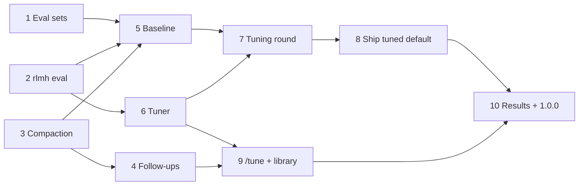

# v1 build docs

This folder lets a thread pick up one v1 step and build it without asking anyone. v1 is the Harness² release, and it ships as 1.0.0 (S-45). It makes the `default` profile measurably better, ships the better version, and lets users improve it on their own work. Alongside that, it adds follow-ups and compaction. The design is the v1 alignment doc ([Claude Doc](https://claude.ai/artifact/LVWSoM6bRFk6kSoWZ1r71Z)), which Rishi agreed on 2026-11-02 with one change: the eval suite is mostly agentic coding, because that's what he and his users run `rlmh` for (S-46): Python repos, website building and GPU kernels (CUDA or HIP) for an LLM engine, plus research questions (S-48).

## How a thread uses it

1. Read this README, then [architecture.md](architecture.md), which pins every path, message and signature v1 adds. Then read [../v0/decisions.md](../v0/decisions.md): v1's picks are S-40 to S-48, and its calls are D-168 onwards.
2. Read your spec in [specs/](specs/), and everything it lists under "Read first". Those lists name whole files on purpose; read them before you write code.
3. Check the v1 table in [../v0/progress.md](../v0/progress.md): every step yours depends on must be `done`. Then set your row to `in progress`, with your thread's name. v0 and v1 share progress.md and decisions.md.
4. Build exactly what the spec lists, and run its tests and the full verify gate (CLAUDE.md).
5. Update your row and the log in progress.md. If you had to change a shared interface, change architecture.md too, and say so in the log.

When a spec is silent, follow [architecture.md](architecture.md). When that is silent, follow [../v0/architecture.md](../v0/architecture.md), which still pins everything v1 doesn't change. If you must make a new call, add it to decisions.md as the next D-number.

## The steps

| # | Spec | Type | Cost |
|---|---|---|---|
| 1 | [Eval sets: 48 tasks across Python, web, kernels, research and search](specs/step-01-eval-sets.md) (script in the RLM repo) | PC | $0 |
| 2 | [`rlmh eval`: run, grade, report, compare](specs/step-02-rlmh-eval.md) | PC | $0 |
| 3 | [Compaction inside a run](specs/step-03-compaction.md) | PC | $0 |
| 4 | [Follow-ups: one conversation across questions](specs/step-04-follow-ups.md) | PC | $0 |
| 5 | [Baseline](specs/step-05-baseline.md) | Spend | ≤ $9 |
| 6 | [Harness² tuner, developer side](specs/step-06-tuner.md) | PC | $0 |
| 7 | [Tuning round](specs/step-07-tuning-round.md) | Spend | ≤ $9 |
| 8 | [Ship the tuned default](specs/step-08-ship-tuned-default.md) | Spend | ≤ $3 |
| 9 | [Harness² for users: `/tune`, `/tuned` and the experience library](specs/step-09-user-tune.md) | PC | $0 |
| 10 | [Experiment write-up and the 1.0.0 release](specs/step-10-results-release.md) | Spend | ≤ $6 |

**In parallel:**
- Steps 1, 2 and 3 have no dependencies, so separate threads can build them at the same time. Step 1's kernel track copies step 2's GPU shim, so it comes last within step 1 if step 2 isn't there yet.
- Step 4 follows 3, and step 6 follows 2; they can run alongside step 5.
- Step 9 can run alongside steps 7 and 8.

**Spending.** The $30 cap (S-44) is split in [architecture.md § 11](architecture.md#11-spending-s-44). Every spend step prints its estimate and waits for Rishi's go in chat.

## Harness² sources

Steps 6, 7 and 9 follow the paper and Google's code as closely as our frozen contract allows. [architecture.md § 7](architecture.md#7-the-harness-tuner-steps-6-and-9) says where v1 departs from them and why.

- Paper: "Harness²: Recursive Agent Harnessing for an Open World", Xu et al., Google Cloud AI Research, arXiv [2610.14224](https://arxiv.org/abs/2610.14224). Also on [Hugging Face](https://huggingface.co/papers/2610.14224), with a [project page](https://harness2.github.io/).
- Code: [google-research/harness2](https://github.com/google-research/harness2), Apache-2.0, read at `6868817518876de8fd170c6a8354daca273b6191`.
- In a cloud container arxiv.org answers 403. Read the paper through the Hugging Face connector (`hf://papers/2610.14224/paper.md`), and the code with `git clone --depth 1` outside both repos.

## Repo rules

- **This repo is public.** Never commit keys, transcripts, gold answers, task data, eval sets or run logs. Eval sets live in `RLM_DATA_DIR` (`D:\RLM-data\harness-eval\`), and eval and tune outputs in the RLM repo's git-ignored `results/harness-eval/`.
- **Prompt v4 is frozen.** Never edit its text, and never let the tuner change it. `test_contract` pins its hash.
- **`training-v4` stays training's.** It gets no compaction, is never a tuning base, and parity must still pass after every step that touches the engine.
- **Never make a call with a user's key that they didn't ask for.** Every test runs offline against fakes. `/tune` runs only after the user has seen its cost and said yes.
- **Never commit or push without Rishi's say-so.** Each push, tag, release and workflow run is its own OK.
- **Spend only after Rishi has seen the estimate and said go**, and only within the step's ceiling. Nothing uses W&B credit.
