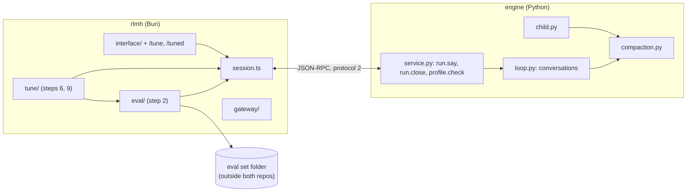

# v1 build architecture

> Written 2026-11-02 for the threads that build v1. v1 adds to v0 rather than replacing it, so [../v0/architecture.md](../v0/architecture.md) still pins everything this file doesn't change. This file pins the names, paths, messages and signatures v1 adds, so threads working in parallel stay compatible. The design is the v1 alignment doc ([Claude Doc](https://claude.ai/artifact/LVWSoM6bRFk6kSoWZ1r71Z)), with Rishi's picks S-40 to S-48 in [../v0/decisions.md](../v0/decisions.md). v1's own calls are D-168 onwards in the same file. If this file and a spec disagree, the spec wins, and this file gets fixed.

## 1. What v1 adds

v1 makes the `default` profile measurably better, ships the better version, and lets users improve it on their own work. The order is measure, tune, then ship. Alongside that, the interactive app gains follow-ups, and long runs gain compaction.

| Part | Where | Steps |
|---|---|---|
| Eval sets: 48 tasks, mostly coding: Python repos, websites, LLM-engine kernels, plus research (S-46, S-48) | RLM repo, `scripts/harness_evalset.py`; data outside both repos | 1 |
| `rlmh eval`: run a set, grade it, report, compare | `app/src/eval/` | 2 |
| Compaction inside a run | `engine/rlm_engine/compaction.py`, `[compaction]` in the profile | 3 |
| Follow-ups: one REPL and conversation across questions | `loop.py`, `service.py`, the interactive app | 4 |
| Harness² tuner, developer side; skills and scripts in `default`-based profiles | `app/src/tune/`, `rlmh tune`; `profiles.py` and the worker | 6 |
| Harness² for users: `/tune`, `/tuned` and the experience library | `app/src/tune/`, `/tune`, `/tuned` | 9 |
| Three spend steps and the release | RLM repo results, `documentation/v1/results.md` | 5, 7, 8, 10 |

The three processes of v0 §1 stay as they are. Nothing new talks to a provider except through the gateway, and nothing new holds a key.



## 2. Repo layout

Each new or changed file, with the step that touches it. Files that v0 created and v1 changes are marked `+`.

```
rlm-harness/
  protocol/examples.json             +3 +4 +6   new methods and events (§3)
  engine/rlm_engine/
    __init__.py                      +3 +10     PROTOCOL_VERSION 2 (step 3); __version__ "1.0.0" (step 10)
    compaction.py                    3          trigger, compact(), the two pinned texts (§4)
    rlmhcontract.py                  D-256      rlmh-1's first messages, observations and cell notes (`Texts`, `V4`, `RLMH1`)
    loop.py                          +3 +4 +6   calls compaction before each root call; conversations (§5); nudges.toml rules (gated, §7.2)
    child.py                         +3 +6      calls compaction before each child turn; skills, scripts and agents in each child's worker init
    bridge.py                        +6         llm(…, agent=) and rlm(…, agent=) look up agents/<name>/AGENT.md (gated, §7.2)
    runlog.py                        +3         FORMAT_VERSION 2, four new keys (§3.4)
    service.py                       +3 +4 +6   window and conversation on run.start; run.say, run.close; profile.check
    link.py                          +4         error -32013 RUN_BUSY beside -32010 to -32012
    followup.py                      4          the pinned follow-up texts: SUBMITTED_NOTE, UNANSWERED_NOTE, FOLLOW_UP (§5)
    profiles.py                      +3 +6      the [compaction] table; TUNABLE, TUNABLE_GATED, FROZEN and check_tunable; skills/ and scripts/, and the gated agents/ and nudges.toml (§7.2)
    worker/worker.py                 +6         under agent_api, the run's copy of the profile's scripts/ goes on sys.path
    worker/agentapi.py               +6         skill(name); agent= on llm and rlm (gated)
    profiles/default/profile.toml    +3 +8      [compaction] (step 3); the tuned values (step 8)
    profiles/default/system.md       D-256 +8   rlmh-1's system prompt, tunable; the tuned text (step 8)
    profiles/default/guidance.md     +8         the tuned text (step 8)
    profiles/default/skills/         8          the tuned skills, if step 7's final/ has any (step 8)
    profiles/default/scripts/        8          the tuned scripts, likewise; agents/ and nudges.toml too if step 7 kept them (D-234)
  engine/tests/
    test_compaction.py               3
    test_conversation.py             4
    test_profile_check.py            6
    test_profile_files.py            6          skills and scripts: loading, the hash, skill(), imports, validation
    test_gated.py                    6          agents and nudges behind the gate
  app/src/
    version.ts                       +3 +10     PROTOCOL_VERSION 2; APP_VERSION "1.0.0"
    protocol.ts                      +3 +4 +6   the §3 types
    session.ts                       +2 +3 +4 +6  Session.open's env (2); window in buildRunParams; say(), closeRun(); run.closed; checkProfile()
    settings.ts                      +4 +9      §8 keys
    paths.ts                         +2 +6 +9   evalDir, tuneDir, libraryDir (§9)
    main.ts                          +2 +6      eval, tune
    cli/eval.ts                      2          rlmh eval, eval report, eval compare, eval ledger
    cli/tune.ts                      6          rlmh tune, with --gated and --gpu (D-254)
    cli/config.ts                    +9         refuses `config set tune.enabled true` (§7.6)
    eval/runner.ts                   2 +6 +9    runEval(): the one entry point for rlmh eval, rlmh tune and /tune; logDir (2), ledger: false (6), its inline form for /tune (9); CostCap (trackedOnly, 9)
    eval/set.ts                      2          read and check a set folder (§6)
    eval/tar.ts                      2          a small ustar reader, the same on every OS; refuses links and path escapes
    eval/work.ts                     2          throwaway work copies and per-repo venvs
    eval/graders.ts                  2          readPassed, gradeRepo (the tests grader) and leakSuspect; re-exports scoreAnswer
    eval/reward.ts                   2          the read grader, a port of reward.py's score_answer: int, float, count, entity, list, text (D-241)
    eval/junit.ts                    2          JUnit XML to per-test results; pytestKey, playwrightKey, resolvedFrom
    eval/testpaths.ts                2          grader.py's test-path rules and PYTEST_BOOT, plus each track's extra test paths (D-241)
    eval/report.ts                   2          report.json, report.md, compare, McNemar
    eval/estimate.ts                 2          the cost estimate before spending (§6.5)
    eval/ledger.ts                   2          <home>/eval/ledger.jsonl
    tune/evidence.ts                 6          the evidence folder, with the grader-leak guard (§7.3)
    tune/sessions.ts                 6          editor, composer and reflector sessions as rlmh runs (§7.4)
    tune/prompts/*.md                6          stage prompts adapted from google-research/harness2 (Apache-2.0 notice kept); surface-gated.md only with --gated
    tune/candidate.ts                6          write a candidate profile folder (skills, scripts and the gated files too), diff it, check it with profile.check
    tune/offline.ts                  6          the set-based driver behind rlmh tune (§7.5), accept() and the estimate
    tune/prompts.ts, tune/text.d.ts  6          stagePrompt(stage, round, {gated, layout}); the .md files are imported as text
    tune/online.ts                   9          the background driver behind /tune: queue, cap, delivery (§7.6)
    tune/worktree.ts                 9          snapshots of the user's folder, and throwaway worktrees (or copies) from them
    tune/library.ts                  6 +9       the experience library (§7.7); step 9 adds user domains
    interface/App.tsx, store.ts      +4 +9      follow-ups; the tune queue, the deferred profile switch, the status line's tune segment
    interface/conversation.ts        4          when a question continues the open conversation (§5)
    interface/commands/index.ts      +9         tune and tuned in COMMANDS
    interface/commands/tune.tsx      9          the /tune on/off screen, with the estimate
    interface/commands/tuned.tsx     9          the /tuned picker
    interface/commands/model.tsx     +9         the tuning model row (tune.model)
  app/test/
    eval/*.test.ts                   2          plus eval/fixture.ts (buildFixtureSet, a test-only ustar writer), the two vectors files and prepare-web.sh
    fixtures/evalset/                2          a tiny set: two read, two Python, one kernel and one web task, with hidden tests
    fixtures/evalset/gpu/            2          gpu.py and gpu_compat.h, the GPU shim every kernel task carries; step 1 copies these bytes (D-223)
    tune/*.test.ts                   6 +9
    interface/conversation.test.ts   4
    interface/tune.test.tsx          9
    interface/tuned.test.tsx         9
  documentation/v1/
    README.md, architecture.md       exists     this kit
    specs/step-01..10                exists
    results.md                       10         the experiment write-up: numbers only, no task text
  documentation/releases/v1.0.0.md   10         release notes; release.yml (+10) puts them above the install text
```

RLM repo (`F:\Personal\RLM\RLM`), as in v0 (S-19). Each change there needs Rishi's OK first.

```
scripts/harness_evalset.py           1          builds and checks the eval set folder (§6)
tests/test_harness_evalset.py        1          offline tests
documentation/harness-eval-v1.md     1 +5 +7 +8 numbers-only summaries; task ids and sizes, never task text
results/harness-eval/<date>-<what>/  5 7 8 10   git-ignored (results/harness-*/ since D-46): rlmh eval and rlmh tune output folders
private/seeds/harness-eval-v1.json   1          git-ignored seeds
```

The eval set itself lives in `D:\RLM-data\harness-eval\harness-eval-v1\` (`RLM_DATA_DIR`), outside both repos (D-169).

## 3. Wire changes: protocol 2

Step 3 bumps `PROTOCOL_VERSION` to 2 in `app/src/version.ts` and `engine/rlm_engine/__init__.py`, and every step that adds a message adds its example to `protocol/examples.json` (D-02). The app already refuses an engine with another protocol (D-36).

### 3.1 App → engine

| Method | Params | Result | Errors | Step |
|---|---|---|---|---|
| `run.start` | v0's params, plus `window: {context_window: int, max_output: int}` (the root model's catalog numbers; 0 means unknown) and `conversation: bool` (default `false`) | as v0 | as v0 | 3, 4 |
| `run.say` | `{run_id, text}` | `{prompt_index: int}`, returned before the prompt's first root call | -32010 no such open conversation; -32013 a prompt is still running | 4 |
| `run.close` | `{run_id}` | `{}`, after `run.closed` was sent | -32010 no such open conversation; -32013 a prompt is still running (use `run.cancel`) | 4 |
| `engine.info` | v0's params | each `profiles` entry gains `path`, `agent_api` and `limits: {read, repo}` (only added fields, so the protocol number doesn't change for it) | as v0 | 2, 6 |
| `profile.check` | `{path: str (absolute folder), base: str \| null (a profile name; null checks the file rules only, with `changed: []`, D-255), gated: bool (default false)}`; `gated` is D-234's | `{ok: bool, errors: [str], prompt_hash, profile_hash, changed: [str]}`; `changed` lists the dotted keys that differ from `base`, plus `"guidance"` when its text differs, plus each skill, script, agent or `nudges.toml` file added, removed or changed, by its path in the folder (`skills/<name>/SKILL.md`, `scripts/<name>.py`) | -32602 for a relative path | 6 |

New error code: **-32013 `RUN_BUSY`**, in `link.py` (beside -32010 to -32012) and `protocol.ts`.

### 3.2 Engine → app

`model.complete` gains an optional `purpose: "compact"` on the summary call of §4 (role `root`, or role `sub` with `child` inside a child run). The gateway treats it as the role it carries: same routing key, same cache markers. The interface labels it "compacting". Step 3.

### 3.3 Events

| Event | Change | Step |
|---|---|---|
| `run.started` | adds `window` (as sent), `compaction: {window, trigger, keep} \| null` (the numbers of §4.1 for this run; `null` when the profile has no `[compaction]`), and `conversation: bool` | 3, 4 |
| `run.compacted` | new: `{run_id, turn, prompt_index, child_id: int \| null, before_tokens, after_tokens, dropped_messages, kept_messages, summary_chars, seconds}` | 3 |
| `run.finished` | adds `prompt_index: int` and `open: bool`. `open` is `true` when a conversation waits for `run.say`; the run's resources stay alive | 4 |
| `run.closed` | new: `{run_id, prompts: int}`, sent once when a conversation ends (`run.close`, cancel, stdin closing). Never sent for a run started with `conversation: false` | 4 |

### 3.4 Run log, format 2

`runlog.FORMAT_VERSION = 2` (step 3). `RECORD_KEYS` keeps v0's order and appends four keys: `window`, `compactions` (the list of `run.compacted` bodies, without `run_id`), `prompt_index`, `conversation`. Step 3 writes `prompt_index: 0` and `conversation: false`; step 4 fills them.

- **One record per prompt.** A conversation writes one line when each prompt ends. All of a conversation's records share its `run_id` and differ by `prompt_index`.
- **`messages`** is the whole list as it stood when that prompt ended, after any compaction: what the model last saw. A reader never has to stitch records together.
- **`turns`, `subcalls`, `children`, `usage`, `cost_usd`, `cache`** cover that prompt only. `diff` (repo mode) is the workspace against `base_tree` when the prompt ended, so it accumulates.
- `/runs` (`runs.ts`) reads format 1 and format 2 lines. A format 1 line gets the four keys as `null`, `[]`, `0` and `false`.

## 4. Compaction (step 3)

### 4.1 When

The profile's `[compaction]` table turns it on. `training-v4` never gets one, so its runs stay byte-identical to training's and still end with the gateway's `context_window` error when they outgrow the model (D-25).

```toml
[compaction]              # default profile
window = 262144           # W': compact as if the model's window were at most this many tokens
keep_ratio = 0.16         # DeepSeek Harness: keep the newest 16% of (W' - out) verbatim
reserve = 65536           # DeepSeek Harness's margin
summary_max_tokens = 8192
```

For each run, from `run.start.window` and the mode's limits (all in tokens):

```
W'      = min(window.context_window if > 0 else ∞, compaction.window)
out     = limits.root_max_tokens
trigger = max(min(0.8 * W', W' - out - reserve), 0.5 * W')      # DeepSeek Harness: min(0.8W, W - output - 65,536)
keep    = floor(keep_ratio * (W' - out))
```

With the default profile on DeepSeek V4.1 Flash or Haiku 5.5 (both about 1M tokens), W' = 262,144, trigger = 180,224 and keep = 39,321. The cap of 262,144 is deliberate: both models have a 1M window, so without it a 150-turn coding run (about 152K tokens) would never compact (D-171).

Before every root call, and before every child turn, the loop estimates the request:

```
estimate = last.input_tokens + last.output_tokens + ceil(chars_appended_since_last_reply / 3)
```

Here `last` is the previous reply's usage. When that reply has no usage, the estimate is `ceil(total_chars / 3)`, which is the gateway's own rule (D-25). The loop compacts when `estimate > trigger`.

### 4.2 How

`compaction.compact(messages, *, keep_tokens, summarize, summary_max_tokens=8192) -> Compacted | None`. It is pure apart from the `summarize` callback, so tests drive it without a model. It builds the summary request itself (COMPACT_REQUEST with `max_words = summary_max_tokens // 5`), and `summarize` returns `""` for a failed call the run can go on from (D-200, D-244).

1. **Head.** `messages[:2]`, the system prompt and the first user message, stay byte for byte. The cached prefix survives.
2. **Tail.** Walk back from the end and keep whole turns while their `chars / 3` fits in `keep_tokens`. A turn is an assistant message plus the observation that follows it (and any other message before the next assistant message; anything before the first assistant message, such as an earlier summary, is middle, D-244). The tail always holds at least the newest turn, and it starts at an assistant message. A native tool call is never separated from its tool result.
3. **Middle.** Everything between head and tail. When it is empty, return `None`: the run goes on, and the gateway's window check stays the last guard.
4. **Summary.** `summarize(messages + [{role: "user", content: COMPACT_REQUEST}])` makes one `model.complete` call:
   - `purpose: "compact"`, with the run's own model, tools, temperature and routing, so the whole prefix is a cache hit
   - `max_tokens: summary_max_tokens`, `thinking: "off"`
   - Its `text` is the summary, and any tool call it makes is ignored. An empty text falls back to a mechanical summary: for each dropped turn, its number and the first line of its code.
5. **Result.** `head + [{role: "user", content: COMPACTED.format(turns=..., summary=...)}] + tail`. That is two user messages in a row; step 3 checks that both clients send them, and that Anthropic's client merges them if it must.
6. **No loop.** A compaction that leaves the estimate above 80% of its old value is the last one for that prompt. Later turns go on uncompacted.

The REPL keeps every variable through a compaction. That is the RLM's edge: `COMPACT_REQUEST` asks the summary to name the variables that hold the state that matters. Step 3 pins the exact texts of `COMPACT_REQUEST` and `COMPACTED` in its spec. They are profile-level additions, not prompt v4.

### 4.3 What it records

The record's `compactions` holds every `run.compacted` body. Each compaction counts as one root call in `usage.root`, or as one sub-call in `usage.sub` inside a child. `run.finished` is unchanged, apart from §3.3.

## 5. Conversations and follow-ups (step 4)

- **Only the interactive app opens one.** `rlmh run`, `rlmh batch`, `rlmh eval` and the tuner always send `conversation: false`, so their runs stay one-shot as in v0 (S-11 holds there).
- **Prompt 0** runs exactly as a v0 run does. When it ends (by submit, by running out of turns, or with no answer), a run with `conversation: true`:
  - writes that prompt's record;
  - sends `run.finished {open: true}`;
  - keeps the worker, bridge, permissions (including "allow for this run"), children, scratch folder and message list;
  - waits for `run.say`, `run.close` or a cancel.
- **`run.say {text}`** starts prompt *k*.
  - The previous prompt is closed with a note (D-201): `SUBMITTED_NOTE` if it submitted, else `UNANSWERED_NOTE`. After an assistant message with a native tool call, the note is that call's tool result; otherwise it starts the user message.
  - Then the user message `FOLLOW_UP`, filled with the text, the mode's `WHERE` phrase, and the turns and sub-calls left.
  - The turn budget and the sub-call budget start over. `submit()` works again, and the answer from earlier prompts is cleared.
  - Mode, profile, models and workspace stay as prompt 0 set them.
  - Step 4 pins the texts of `SUBMITTED_NOTE`, `UNANSWERED_NOTE` and `FOLLOW_UP`.
- **Compaction (§4) covers the whole conversation.** The head stays prompt 0's system and first user message. A follow-up's note and `FOLLOW_UP` belong to the turn before them (D-244), so when a compaction in prompt *k* drops that turn, the loop adds `followup.KEPT_FOLLOW_UP` with prompt *k*'s text right after the summary: the model always sees the question it is answering, whichever summary was written (D-248).
- **The wall cap.** The worker's wall cap is per cell (`manager.py`), so it already holds for each prompt, with no change.
- **Ending a conversation.** `run.close`, `run.cancel` or the engine's stdin closing ends it. The worker closes, model calls are cancelled, the scratch folder goes, and `run.closed` is sent. A cancel during a prompt also writes that prompt's `cancelled` record first, as in v0.
- **In the app.**
  - A question becomes a follow-up when a conversation is open, `conversation.follow_ups` is on (§8), and the question picks the same mode as the open conversation:
    - Read mode needs no new `@` mentions.
    - Repo mode needs the same folder.
  - Anything else closes the open conversation and starts a new one. So do `/clear`, a model or profile change, and quitting.
  - The status line shows the prompt number when it is above 0.
- **Under `training-v4`** follow-ups work, but the profile has no compaction (§4.1). A long conversation can still hit the window and end with `context_window`.

## 6. Eval sets and `rlmh eval` (steps 1 and 2)

### 6.1 The set folder

Step 1 writes it and step 2 reads it. The model never sees anything but the task text, the read inputs and its work copy.

```
<set>/
  manifest.json     {format: 1, name, created, builder: {repo: "RishiJain905/rlm", commit, dirty}, permission_mode,
                     validated, kernel_validated_on: ["hip"|"cuda", ...], counts: {"<split>/<track>/<size>": n}, tasks_sha256, grades_sha256}
  tasks.jsonl       what rlmh is given, one task a line, never gold (§6.2)
  grades.jsonl      how each task is graded (§6.3); gold and test lists live only here
  ctx/<id>/...      read-mode inputs, written as bytes
  repos/<id>.tar    repo-mode base snapshot: the repo after the break, hidden tests removed, no .git
  hidden/<id>.tar.gz the hidden test files, restored only after the run ends
  venvs/<key>.json  {python: "3.12", requirements: [pinned lines], import_root: "." | "src"} for each Python repo and kernel task
  nodeenvs/<key>.json {node: "22", pnpm: "<exact version>", playwright: "<exact version>"} for each web project; its pnpm-lock.yaml is in the repo tar
```

The set has five tracks (D-176, S-48). Each split holds half of every cell:

| Track | Kind | Source | S | M | L | R | Tests |
|---|---|---|---|---|---|---|---|
| `python` | repo | training's held-out edit tasks (bug, feature, real PR, spec, multi-bug) | 6 | 6 | 4 | | pytest in a uv venv |
| `web` | repo | Web-Bench projects (ByteDance, Apache-2.0): build a site from its first 3, 6 or 12 feature requests (D-222) | 4 | 4 | 2 | | Playwright in Chromium |
| `kernel` | repo | GPU kernels for an LLM inference engine, written for this set in one CUDA/HIP dialect; run on an NVIDIA or AMD GPU (D-223) | 4 | 4 | 2 | | pytest against NumPy; compiled at run time by NVRTC or hiprtc |
| `research` | read | training's `research_test`: multi-hop and list questions over 330K to 610K characters (D-224) | | | | 8 | `answer` grader |
| `search` | read | training's `callgraph_heldout` and `needle_heldout` | | | | 4 | `answer` grader |

### 6.2 `tasks.jsonl`

```
read: {"id", "kind": "read", "track": "research"|"search", "split": "tune"|"heldout", "size": "R", "question", "input": ["ctx/<id>/<file>", ...]}
repo: {"id", "kind": "repo", "track": "python"|"kernel"|"web", "split", "size": "S"|"M"|"L", "task", "base": "repos/<id>.tar",
       "venv": "<key>" (python, kernel) | "node_env": "<key>" (web), "test_hint", "requires": ["gpu"] (kernel only)}
```

- **Ids** are `<set>-<track>-<size>-<nn>`, and reveal nothing about content.
- **`test_hint`** is `{python} -m pytest -q <paths>` for `python` and `kernel` (a kernel task's `kernels.py` loads its kernel source through the task's `gpu.py` shim, for CUDA or HIP), and `{pnpm} exec playwright test` for `web`. `{python}` becomes the absolute path of the task's venv interpreter and `{pnpm}` the dev machine's pinned pnpm, so the run needs no global packages.
- **Paths** are relative to the set folder.

### 6.3 `grades.jsonl`

```
read: {"id", "grader": "answer", "gold", "grading": {...}, "pass_score": 1.0}   # the RLM task's own grading fields; type int, float, count, entity, list or text
repo: {"id", "grader": "tests", "runner": "pytest"|"playwright", "hidden": "hidden/<id>.tar.gz",
       "f2p": [test ids], "p2p": [test ids], "files": [test file paths to run], "timeout_s": int}
```

Where each task came from stays in step 1's build cache (`sources.jsonl`), never in the set. `validated` is false only for a `--no-validate` test build, and `rlmh eval` refuses such a set.

The read grader ports `rlm_rl/reward.py`'s `score_answer` for the types int, float, count, entity, list and text (an exact or alias match, else 0.8 × token F1; no judge model). Expected test values come from running training's functions in a scratch copy. For the primary metric, a read task passes when its score reaches its `pass_score`: 1.0, except 0.8 for research list questions, training's open-book bar (D-170, D-224). For a repo task, `resolved` means every f2p test passes and every p2p test passes too: as training's `score` counts them, a p2p test that is missing, skipped, failed or in error fails the task (D-240). `f2p_share` is the fraction of f2p tests that pass, a secondary metric that breaks ties (D-170).

### 6.4 Running a set

`rlmh eval` drives the same `Session` as `rlmh batch`, with `conversation: false`.

1. **Read tasks** run with `inputs` resolved against the set folder.
2. **Repo tasks** each get a fresh work copy, `<home>/eval/work/<eval id>/<task id>/`:
   - `repos/<id>.tar` is extracted as bytes;
   - then `git init`, and one commit `base` by `rlmh-eval <eval@localhost>` with a fixed date, so the history gives nothing away;
   - a web task then gets `pnpm install --offline --frozen-lockfile --store-dir <home>/eval/pnpm-store` (hard links from the shared store; `node_modules` is git-ignored in the copy);
   - `test_hint` is filled.

   Web tasks run one at a time until their grading ends, because the model's own test runs serve the site on Web-Bench's default port. Kernel tasks run one at a time too, because they share one GPU. The two groups can overlap.
   - **GPU check.** Only when the selection holds a task with `requires: ["gpu"]`, env prep has the kernel venv's Python run a one-line probe through `gpu.py`. It prints only the backend (`cuda` or `hip`) and a device count: never a device name, UUID, serial or driver version, and never through `nvidia-smi`. The shim reads the GPU's compile target (`sm_XX` or `gfx…`) inside the process, because the compiler needs it, and never prints or records it. `--gpu cuda|hip|none` overrides it (`none` leaves the kernel tasks out). With no GPU, `rlmh eval` exits 2 and names those tasks, so nothing is spent. The backend reaches runs and grading as `RLMH_GPU_BACKEND`, and `eval.json` records `gpu_backend` and nothing else about the GPU. Plain `rlmh` runs never probe.
3. **Permission mode.** The run uses the manifest's `permission_mode`, `bypass` for this set (D-172), printed in the estimate. Without the model's own shell, a coding agent can't run tests.
4. **Grading, after `run.finished`:**
   - revert any change to a test path (`tests/`, `test/`, `test_*.py`, `*_test.py`, `*.spec.*`, `conftest.py`, `pytest.ini`, `tox.ini`, `setup.cfg`, `pyproject.toml`'s pytest table, `playwright.config.*`, `package.json`, `pnpm-lock.yaml`, `vendor/`; for kernel copies also `gpu.py`, `gpu_compat.h` and `kernels.py`), and set `test_tamper` if there was one;
   - extract the hidden tests;
   - **pytest** (`python`, `kernel`): run `{python} -c <PYTEST_BOOT> -p no:cacheprovider -o junit_family=xunit1 --junitxml=<grade dir>/junit.xml --tb=short -q <files>` with `timeout_s`, key-like variables stripped, and `PYTHONUTF8=1` (D-230: the tasks were made on Linux, and on Windows a test that opens a data file with the default encoding would read it as cp1252) (`PYTEST_BOOT` is training's, from `rlm_rl/grader.py`). When the venv's `import_root` is `"src"`, a `.pth` file points the venv at the work copy's `src/` for that run only;
   - **playwright** (`web`): run `{pnpm} exec playwright test --reporter=junit --retries=0 <files>` with `PLAYWRIGHT_JUNIT_OUTPUT_NAME=<grade dir>/junit.xml`, `EVAL_PROJECT_PORT` set to a free port the runner picks, `CI` unset (Web-Bench's config retries under it), `IS_EVAL_PRODUCTION=1` (Web-Bench's own grading timeouts), `PLAYWRIGHT_BROWSERS_PATH`, `timeout_s` and key-like variables stripped. A test id is the JUnit `classname` (with `/` separators) `::` its `name`;
   - parse the JUnit report.
5. **Leak check.** `leak_suspect` is set when the run's messages contain the set folder's path or a hidden test's name.
6. **Clean up.** The work copy is removed after grading, unless `--keep`.

**Environments are made once, before the first run that needs them:**
- venvs per key, `<home>/eval/venvs/<key>/`, with `uv venv --python <python>` and `uv pip install -r`. A python venv's frozen requirements already hold `tzdata` (D-230), so `zoneinfo` works on Windows. Kernel venvs pin `numpy`, `pytest` and the pip NVRTC wheel (`nvidia-cuda-nvrtc-cu12`): `harness-eval-v1` and the fixture pin `numpy==2.5.4`, `pytest==9.1.1` and `nvidia-cuda-nvrtc-cu12==12.9.86` (off on macOS). The `cuda` backend needs only the NVIDIA driver; the `hip` backend needs the AMD HIP SDK on Windows or ROCm on Linux, installed by the machine's owner;
- for web tasks, `node` 22 or later and the pinned `pnpm` (10.34.7, with Playwright 1.57.0, D-227) must be on PATH. `pnpm fetch` fills `<home>/eval/pnpm-store/` from each project's lockfile, and `pnpm exec playwright install chromium` puts one Chromium in `<home>/eval/ms-playwright/`. `rlmh eval` sets `PLAYWRIGHT_BROWSERS_PATH` and `IS_EVAL_PRODUCTION=1` in the engine's environment, so the model's own Playwright runs find that browser.

That is a developer action that touches PyPI, the npm registry and Playwright's browser download, and the estimate says so.

### 6.5 Commands and output

```
rlmh eval SET [--split tune|heldout|all] [--only ID,...] [--sample K --seed S] [--root M] [--sub M] [--profile P]
              [--call-format F] [--jobs N] [--out DIR] [--tokens-from RUNS.jsonl]... [--go] [--max-usd X] [--keep] [--json]
rlmh eval SET --rerun OUT [--go] [--max-usd X]
rlmh eval report OUT
rlmh eval compare OUT_A OUT_B
rlmh eval ledger
```

- **Without `--go`** it is an estimate and spends $0. It prints the planned runs, the price per run by size from the catalog and reference tokens, the total, and the cap.
- **`--go`** spends. `--max-usd` is a hard stop, defaulting to 2× the estimate: once the gateway's billed cost passes it, no new run starts and the running ones are cancelled.
- **Account stops (D-257).** A graded run that ends with an account kind (`ACCOUNT`: `no_credit`, `auth`, `no_key`) stops the eval the same way: no new run starts, the running ones are cancelled, every task not graded gets that kind, `eval.json`'s `account_stop` names it, and `rlmh eval --go` exits 1 and says what to fix. The account kinds are never transient.
- **`--out`** defaults to `<home>/eval/out/<eval id>/`, with eval id `<set>-<split>-<YYYYMMDD-HHMMSS>`. Spend steps pass `--out` into the RLM repo's `results/harness-eval/`.
- **`--rerun OUT`** reruns only the tasks in `OUT` that ended with a transient infra error (`TRANSIENT`, never an account kind), into `OUT/rerun/`. `report` and `compare` prefer the rerun lines.
- **`--sample K --seed S`** picks K tasks, stratified by track and size, the same K for the same seed. It is the probe subset of §7.5.

```
<out>/
  eval.json        id, set name and folder, manifest hashes, split, task ids, models, profile, profile_hash, prompt_hash, call_format,
                   jobs, harness version and commit, estimate, cap, capped, account_stop (D-257), cost_usd, rerun_of, gpu_backend, started, finished
  runs.jsonl       the engine's run log (logDir = <out>)
  grades.jsonl     one line per task: id, track, kind, size, split, run_id, submitted, infra_kind, pass, score, f2p_share,
                   test_tamper, leak_suspect, turns, subcalls, compactions, cost_usd, cache_hit, input_tokens, cache_read_tokens,
                   wall_s, grade_error, env_log (D-239)
  grade-logs/<id>/ the test runner's output and junit.xml (the tuner never reads this folder, §7.3)
  report.json      totals by split, track, kind and size: n, pass rate, mean score, mean f2p_share, turns, sub-calls,
                   compactions, cost, cache hit, wall time, infra errors
  report.md        the same as tables
```

- **`compare`** pairs the ids both outputs have. It gives both pass, A only, B only and neither; McNemar's exact p; the pass-rate difference; pass counts per track; mean `f2p_share`; and the cost ratio.
- **The ledger.** Every `--go` appends `{date, what: "eval"|"tune", set, split, root, profile, runs, cost_usd, out}` to `<home>/eval/ledger.jsonl`. `rlmh eval ledger` prints the lines and the total against S-44's $30.

### 6.6 The estimate

`eval/estimate.ts` prices each planned run as `reference tokens × catalog price`.

- **Reference tokens** are the mean `usage.root` and `usage.sub` by track and size, from the run logs passed with `--tokens-from` (repeatable).
- **Fallback.** With none, it uses these built-in reference figures, from v0's recorded runs (D-152, D-157):

| Size | Root in (M) | Root out (K) | Sub in (M) | Sub out (K) |
|---|---|---|---|---|
| R | 0.3 | 20 | 0.3 | 30 |
| S | 0.3 | 20 | 0.1 | 10 |
| M | 1.2 | 50 | 0.3 | 30 |
| L | 6.0 | 120 | 0.8 | 60 |

- **Profile cap.** Each figure is capped at the profile's own ceiling for that mode, using `scripts/harness_smoke.py`'s `ceiling_tokens` formula on the mode's limits, so a 30-turn profile such as `training-v4` is never priced as a 150-turn one. `engine.info`'s profile entries carry each mode's limits for this purpose (step 2 adds them if they are missing).
- **Cache.** Reads are assumed at 80% for root input on providers that cache, as v0 measured on DeepSeek; it is 0% elsewhere. OpenRouter can bill from 0.1× to 3× the catalog (D-121), so the default cap is 2× the estimate.

## 7. The Harness² tuner (steps 6 and 9)

Read the paper and the code before building either step:

- **Paper:** Xu et al., "Harness²: Recursive Agent Harnessing for an Open World", arXiv [2610.14224](https://arxiv.org/abs/2610.14224) ([Hugging Face page](https://huggingface.co/papers/2610.14224), [project page](https://harness2.github.io/)).
- **Code:** [google-research/harness2](https://github.com/google-research/harness2), Apache-2.0, read at `6868817518876de8fd170c6a8354daca273b6191`. The files to read are:
  - `harness2/core/prompts.py`: `propose()` L824, `aggregate()` L893, `compose_round()` L964, `select()` L1040, `experience()` L1105, `GENERALIZE` L295, `_INV_TEMPLATE` L347, `_DOM_TEMPLATE` L372
  - `harness2/core/recursion.py`
  - `harness2/core/context.py`
  - `harness2/core/library.py`
  - `harness2/core/selection.py`
  - `harness2/core/ledger.py`
  - `harness2/core/tree.py`
  - `harness2/core/schedule.py`
  - `scripts/split_tasks.py`

### 7.1 How v1 maps the paper

| Harness² | v1 |
|---|---|
| The model is frozen and the harness evolves | The call format and the one `python` tool are frozen (S-09), and so is prompt v4 for `training-v4` (S-14). Since D-256 `default`'s system prompt is its own `system.md`, which evolves with `guidance.md`, the tunable TOML keys, skills and scripts (levers 3 and 4, §7.2) |
| 8 harness components (C1–C8) | C1 to C4 are covered by `guidance.md`. Skills (C6) and scripts (C7) are tunable: `skills/<name>/SKILL.md`, printed by the REPL helper `skill(name)`, and `scripts/<name>.py`, imported in the REPL (D-233). Named subagents (C5) and declarative nudges (C8) are built behind a gate, off by default, and stay only if step 7 shows a tunable gain (D-234). Code plugins are out: tuned code in the engine's tool loop would run outside the worker's audit hooks |
| Two scoped editors: INV ("how the agent works") and DOM ("what a practitioner knows") | The same two editors with the same scopes. INV may also change TOML limits; DOM changes text only |
| Probe each candidate once | Probe each candidate on a fixed probe subset of the tune split (offline), or once on the task (online) |
| Composer: merge, revise, adopt or KEEP_BASE, with notes "kept\|revised\|dropped -> edit -> evidence" | The same, as a composer session |
| Editors and the composer never see a score or verdict (`context.py` guards) | The same: evidence holds trajectories and deliverables, never `grades.jsonl`, `grade-logs/` or gold (§7.3) |
| Online and label-free: each task is re-run on itself | User `/tune` (§7.6): an on/off switch; while on, each task the user finishes is tuned in the background, with the user's own run as the reference (D-231) |
| Meta-Harness baseline: offline search, replicates, acceptance margin, a lessons file (paper Appendix C) | Developer `rlmh tune` (§7.5). It is offline, uses labels for acceptance only, and adds a held-out check against `v1-baseline` (step 8) |
| The library: a reflector writes at most one lesson per task, NO_ENTRY by default, with cue lines in `INDEX.md` | The experience library (§7.7). It is read by later editor sessions and is not injected into ordinary runs (D-175) |
| Editor and composer: Claude Opus 4.8 under OpenCode; Figure 8 shows the executor model can edit too | Every session runs on the tuning model, as an rlmh read run over the evidence (§7.4). Offline it is DeepSeek V4.1 Flash 1017 (S-43). For users it is `tune.model`, picked in `/model`, the root model when empty; the reference, probe and composed runs always use the user's root and sub models (D-232) |

### 7.2 What may change

`profiles.TUNABLE` (step 6) is the only list of keys a candidate may change, with bounds. `profiles.check_tunable(base, candidate) -> list[str]` returns the problems.

| Key | Bounds |
|---|---|
| `system.md` (rlmh-1 profiles, D-256) | at most 16,000 characters, UTF-8, LF line ends; `{shell}` the only placeholder; a v4 profile never has one |
| `guidance.md` | at most 12,000 characters, UTF-8, LF line ends; `{shell}` stays the only placeholder |
| `read.max_turns`, `repo.max_turns` | 10 to 200 |
| `read.max_subcalls`, `repo.max_subcalls` | 10 to 200 |
| `read.submit_check` | 0.0 to 1.0 (D-251's check, `[read]` only; D-252) |
| `repo.subcall_thinking` | `off`, `low`, `medium`, `high` |
| `repo.pace_nudge` | bool |
| `root.temperature`, `sub.temperature` | 0.0 to 1.0 |
| `rlm.max_runs` | 0 to 24 |
| `rlm.max_turns` | 5 to 60 |
| `rlm.max_parallel` | 1 to 8 |
| `compaction.window` | 65,536 to 1,048,576 |
| `compaction.keep_ratio` | 0.08 to 0.32 |

Every other key is frozen, and a candidate that changes one is invalid: `contract`, `cache_api`, `agent_api`, every `*_max_tokens`, `output_max_chars`, `cell_timeout_s`, `subcall_max_chars`, `subcall_oversize`, `rlm.max_depth`, `compaction.reserve` and `compaction.summary_max_tokens`. `training-v4` is never a base.

**Skills and scripts** (D-233, step 6). A profile with `agent_api = true` may also hold:

```
<profile>/skills/<name>/SKILL.md    front matter `name` (equal to the folder) and `description` (one line), then the text
<profile>/scripts/<name>.py         a deterministic helper module, standard library only
```

- **At run time.** `skill(name)` in the REPL prints the skill's text; nothing is loaded until the model calls it, so the root prompt doesn't grow. `skill()` prints each name and description. The engine copies `scripts/` into the run's scratch folder, and the worker puts that copy on `sys.path`, so `import <name>` works and a run never changes the profile. Scripts run inside the worker under the same audit hooks and permission mode as model-written code.
- **Validation** (harness2's three rules, then the bounds), in `check_tunable` and `profile.check`:
  - every skill's name appears verbatim in `guidance.md` (its trigger line);
  - every script that `guidance.md` or a skill names as `scripts/<name>.py` ships in the profile;
  - every script compiles, and imports only the standard library (`sys.stdlib_module_names`, checked on the AST);
  - at most 16 skills of at most 8,000 characters each, and at most 16 scripts of at most 16,000 characters each (step 6 may change these with a logged reason);
  - a skill name matches `[a-z0-9][a-z0-9-]{0,47}`; a script name is a lowercase Python identifier that is neither a standard-library module nor a REPL name;
  - every file is UTF-8 with LF line ends and no NUL, and a candidate folder holds nothing else beside `profile.toml`, `guidance.md` and these folders.
- **Never under `training-v4`.** A profile without `agent_api` that holds `skills/` or `scripts/` fails to load, so `training-v4` never gets either, and parity is unaffected.
- **The hash.** A profile with none of these files hashes as before (`profile.toml`, a NUL, `guidance.md`), so `v1-baseline`'s and `training-v4`'s hashes don't move. Otherwise each such file (the gated files below included) is appended in sorted path order, as a NUL, its path with `/`, a NUL, and its bytes.

**Named subagents and nudges, behind a gate** (D-234, step 6). Built and tested, but off by default: `profiles.GATED = False`. The gate is on only when that constant is true, or when the engine starts with `RLMH_TUNE_GATED=1`, which `rlmh tune --gated` sets for its own engine. With it off, a profile that holds either fails to load, and neither is in `TUNABLE`. Step 7 decides whether they stay (§7.5).

```
<profile>/agents/<name>/AGENT.md    front matter `name` and `description`, then a system prompt for a bounded job with a large input and a small answer
<profile>/nudges.toml               [[nudge]] rules, declarative only: never code
```

- **`agents/`.** `llm(..., agent=name)` sends the agent's text as the sub-call's system message; `rlm(..., agent=name)` puts it ahead of the child's task. At most 8 agents of at most 4,000 characters each, and each name appears verbatim in `guidance.md`.
- **`nudges.toml`.** Each `[[nudge]]` has `when` (`error`, `no_submit` or `long_output`), its threshold (`pattern`, a plain substring of a cell's output or error, at most 200 characters; `turns`, 1 to 200, for turns with no `submit`; `chars`, 1,000 to 1,000,000, for a cell's output length) and `hint` (at most 400 characters). `loop.py` appends a matching rule's hint to that turn's REPL output, at most once per rule per prompt. At most 8 rules.
- **`TUNABLE_GATED`** lists both, with these bounds, beside `TUNABLE`. `check_tunable(base, candidate, gated=False)` refuses either file unless `gated` is true or `GATED` is; `rlmh tune --gated` passes `gated: true` to `profile.check`. These bounds are step 6's starting values, which it may change with a logged reason. Plugins as code are out (D-234).

### 7.3 Evidence

`tune/evidence.ts` writes one folder for each session:

```
evidence/
  harness/profile.toml, harness/guidance.md    the harness under review
  harness/skills/, harness/scripts/            its skills and scripts, if any (and agents/, nudges.toml under the gate)
  tasks/<id>/task.md                           the task text, as rlmh gave it
  tasks/<id>/<run label>/trajectory.md         every turn: reply, code, output, error, sub-call summaries, compactions
  tasks/<id>/<run label>/deliverable.md        the diff (repo mode) or the submitted answer (read mode)
  candidates/<name>/diff.md, notes.md          (composer only) each candidate's edit and its editor's notes
  history.md                                   earlier rounds' composer notes
  library/INDEX.md, library/entries/...        the experience library for this domain (§7.7)
```

**Grader-leak guard.** `writeEvidence` refuses, and throws, if anything it is about to write comes from `grades.jsonl`, `grade-logs/`, a hidden tar or a `gold` field, or if a written file holds a grade marker. A run whose own text names the set folder, a hidden tar's member or an f2p id is withheld instead (D-205; not the p2p ids or `files`, which name tests the repository already has, D-253). `harness/system_prompt.md` is the first reference record's system message (D-255). Its test plants each of those and expects the refusal. This follows `harness2/core/context.py`.

### 7.4 Sessions

Every session is an rlmh read run through `Session`. The question is a stage prompt, the inputs are the evidence files, the profile is the built-in `default` of the running harness (never a candidate), and the model is the tuning model: `--root`/`--sub` for `rlmh tune`, and `tune.model` as root and sub for `/tune` (D-232). The model then reads the evidence through its REPL and sub-calls, which is the RLM idea applied to the paper's evidence folders (D-174). The session submits one JSON object as a string, `submit(json.dumps({...}))`, because `submit` refuses a dict:

| Session | Prompt (adapted from `prompts.py`) | Submits |
|---|---|---|
| Editor INV, editor DOM | `propose()` with `GENERALIZE` and `_INV_TEMPLATE` or `_DOM_TEMPLATE` | `{decision: "EDIT"\|"KEEP_BASE", notes: [str], guidance: str \| null (null keeps the base's text), toml: {"<table>.<key>": value}, files: {"<path>": str \| null}}`; `files` holds only the skills and scripts it adds, changes (text) or removes (null), by path in the folder; DOM's `toml` must be empty |
| Composer | `aggregate()` | `{decision: "MERGE"\|"ADOPT"\|"REVISE"\|"KEEP_BASE", adopt: "inv"\|"dom"\|null, notes: [str], guidance, toml, files}` |
| Reflector | `experience()` | `{domain, entry: "NO_ENTRY" \| {cue, lesson, evidence, confidence}, edits: [...]}`, each edit with the fields `experience()` asks for, its verdict one of "helped", "hurt", "no observed effect", "confounded" |

- **A bad session.** An invalid submission (wrong shape, or `profile.check` not ok) gets one retry with the errors appended to the question. After that, the stage keeps its base, as `recursion.py` does.
- **Size.** `submit` refuses an answer over `SUBMIT_MAX_BYTES` (100,000), so `submit.md` asks for the few files an edit changes, never the whole folder.
- **Licence.** The prompts in `tune/prompts/` keep harness2's Apache-2.0 notice and name the source file and commit.

### 7.5 `rlmh tune`, offline (step 6, run at step 7)

```
rlmh tune SET --root M [--sub M] --base PROFILE --name NAME (--from EVAL_OUT | --continue OUT) [--rounds 2]
              [--probe 10 --seed S] [--jobs N] [--tokens-from RUNS.jsonl]... [--out DIR] [--gpu cuda|hip|none] [--go] [--max-usd X] [--gated]
```

`--gated` turns on D-234's gate for this tune: its engine starts with `RLMH_TUNE_GATED=1`, the editors' prompts gain `surface-gated.md`, and `profile.check` gets `gated: true`. Step 7 runs round 1 with and without it, and C5 and C8 stay in the tunable surface only if a candidate using them is adopted and the gated round passes more tune tasks at no more mean cost per task than the round without it (D-234). When they stay, step 7 moves `TUNABLE_GATED`'s rows into `TUNABLE` and turns the gate on by default (`profiles.GATED = True`). Otherwise they stay out of `TUNABLE` and their code stays off. Either way the result is logged as a D-number.

At step 7, `--base` is `v1-baseline`: the user profile step 5 creates as a byte copy of the built-in `default` after step 3, checked by its hash in steps 7, 8 and 10. Rounds are budget-driven. Round 1 always runs, and each later round runs only if its estimate (re-made from the runs so far, with `--tokens-from`) fits in what is left of `--max-usd`; `--rounds` is the maximum.

Per round *r* (incumbent = `--base` at round 1):

1. **Reference.** The incumbent's tune-split eval. Round 1 reuses `--from` (the tune half of step 5's baseline) instead of spending again; `--continue OUT` continues a finished tune with more rounds; a tune that stopped (cap or error) can't be resumed.
2. **Edit.** Evidence over the reference runs, then the INV editor and the DOM editor. That gives at most two candidates, written under `<out>/rounds/<r>/profiles/` and installed into `<home>/profiles/` only while they run.
3. **Probe.** Each candidate runs on the probe subset: `--probe` tasks from the tune split, `--sample` with `--seed`, fixed for the whole tune.
4. **Compose.** The composer session reads the reference runs, both candidates' probe runs, their diffs and their notes. It writes `<NAME>-r<r>`.
5. **Accept.** The composed profile runs on the whole tune split. It becomes the incumbent only when:
   - its pass count is at least the incumbent's + 1,
   - its mean `f2p_share` is not lower,
   - and its mean cost is at most 1.5× the incumbent's (D-173).
6. **Reflect.** The reflector session writes at most one lesson to `<out>/library/`.

An account kind (D-257: `no_credit`, `auth` or `no_key`) from any eval of the round (probe, composed or rerun) or any session ends the tune at once with `stopped: "error"`: no later stage, no rerun, no verdict and no library entry for that round. `tune.json` records `account_stop` (the kind) and `stop_reason`, and `rlmh tune` exits 1 and says what to fix.

The output folder `<out>/` holds:
- `tune.json`, with every stage's profile hash, decision, pass counts and cost, and `stopped`, `budget_stop`, `account_stop` and `stop_reason`;
- `rounds/<r>/{evidence-*/, sessions/, evals/}`;
- `library/`;
- `final/`, a copy of the last incumbent's folder.

`--max-usd` covers everything in the tune, and the estimate before `--go` lists every stage. The held-out split is never touched here: step 8 checks it, and ships the tuned profile only if it passes more held-out tasks than `v1-baseline` at a mean cost at most 1.5 times `v1-baseline`'s (D-173).

### 7.6 `/tune`, online, for users (step 9)

This is Harness²'s own setting, at k = 1, run over the stream of the user's real tasks in order, as `schedule.py` runs a domain's tasks (D-231).

- **Two switches.** Which harness is active is the `profile` setting. Whether Harness² runs is `tune.enabled`, `false` by default. A user can stay on a tuned profile with tuning off, and spend nothing on it.
- **`/tuned`** lists the built-in `default` first, then every `tuned-<YYYYMMDD-HHMM>` profile newest first, and marks the active one. Enter sets `profile` to it. It never spends, and the choice stays across sessions until the user switches again.
- **`/tune`** shows the state (on or off, the spend against the cap, the tune in flight and the task waiting) and toggles it. `/tune on` first shows the estimate and the cap, and turns on only after a yes. `/tune off` cancels the tune in flight and drops the waiting task. `tune.enabled` can be set to `false` anywhere, but to `true` only through `/tune on`: `/settings` and `rlmh config set` refuse it with a hint.
- **A task** is the first prompt of a conversation (`prompt_index` 0) that the user runs in the interactive app with tuning on, and that ends with a submit and no infra error, under a profile that can be a base (not `training-v4`). Follow-up prompts aren't tuned, because they rely on REPL state a fresh run doesn't have. `rlmh run`, `rlmh batch` and `rlmh eval` are never tuned.
- **Per task**, in the background, from the task's `run.finished`:
  - the user's own run is the reference (D-231), so no reference run is made;
  - the INV and DOM editors;
  - a probe run of each candidate that differs from the base;
  - the composer;
  - one composed run, unless it equals the base;
  - the reflector, with `tune.library` on.

  That is at most three runs and four sessions (three with the library off). A stage whose profile equals its base isn't run (D-216).
- **Models.** The sessions run on `tune.model`, the root model when it is empty. The probes and the composed run use the user's root and sub models, because the harness is fitted to that executor (D-232).
- **Snapshot.** With tuning on, each repo task's starting state is recorded before its run begins (a task is defined above). In git, it is a commit of the working tree, untracked files included and ignored ones not, built through a temporary index (`GIT_INDEX_FILE`) with `add -A`, `write-tree` and `commit-tree`, with hooks and filters off as D-219 has them. No ref is made, and the user's index, branch and files are untouched. Outside git, it is a copy under D-219's limits in `<home>/tune/snapshots/`. A folder over the limits isn't tuned, with a note. The probes and the composed run start from the snapshot, in a throwaway `git worktree add --detach` at that commit, or in a copy of the copy. Read tasks re-read the same input paths, and a missing one skips the task.
- **No approval prompts.** Background runs are non-interactive, so anything that would ask is denied, as in every non-interactive run (D-15). Otherwise they use the user's next-run permission mode. This replaces D-217.
- **Order.** One tune runs at a time. A task that finishes while one runs waits; at most one waits, and a later one is skipped with a note. A waiting task whose run used a profile that is no longer active is skipped. Quitting cancels the tune in flight and drops the waiting task.
- **Delivery.** At k = 1 the composed harness is delivered as the paper does, except that it is dropped when its run had an infra error or delivered nothing, or when `tune.test` is set, the reference's test exits 0 and the composed run's doesn't (D-218, D-231). The reference's test runs in a throwaway worktree (or copy) of the snapshot with the run's recorded `diff` applied (`git apply`); if the diff doesn't apply, the test rule is skipped and `tune.json` says so. Test output never reaches the evidence.
- **Becoming active.** A kept harness is written as `<home>/profiles/tuned-<YYYYMMDD-HHMM>/` (`-2`, `-3` and so on when the name is taken), with a line in `<home>/tune/tuned.jsonl`, and becomes the active profile: at once when no conversation is open, otherwise when the open one ends, so tuning never closes a conversation under the user (D-178). If the user switched profiles in the meantime, the switch is dropped, and the profile is still in `/tuned`. The next task's base is the profile its own run used, so the harness each task delivers is the next one's base (D-215).
- **Cost first.** `/tune on` shows the estimate per task, for read and for repo: up to 3 runs at the median cost of the user's last 20 runs in that mode with the root model, plus 4 sessions (3 with the library off) at the median cost of earlier `/tune` sessions on `tune.model`, each falling back to §6.6's figures (D-221, D-231, D-232). The screen says that the runs, on the root model, are most of the cost. It turns on only after an explicit yes.
- **The cap.** `tune.max_usd` counts every `/tune` run and session since `/tune on`; the user's own runs don't count. `<home>/tune/online.json` holds `on_since`, and the spend is summed from the `tune-*` run logs since then, so it survives a restart. When the cap trips, the tune in flight is cancelled, `tune.enabled` turns itself off, and the transcript says so. While tuning is on, the status line shows `tune on` and the spend against the cap.
- **Runs.** Every `/tune` run and session is a normal run with `conversation: false`, `interactive: false` and a `tag` of `tune:<id>:<stage>`, logged under `<home>/runs/tune-<id>/`, so `/runs` shows them. `<id>` is `t_<YYYYMMDD-HHMMSS>`, one per tuned task.
- **runEval's inline form** (step 9). `runEval({inline: InlineTask[], …})` runs in-memory tasks (`{tag, mode, question, inputs}` or `{tag, mode, task, testHint, workCopy}`) one after another on the given session, with no set, no grading and no ledger line; `out` gets `eval.json` only. Its options are `permissionMode`, `interactive` (default false), `batch`, `logDir`, `sharedBus` (count only its own runs' cost, since the interactive app's bus carries the user's runs too) and `track` (an outer cap sees each run id); `workCopy()` makes a repo run's folder just before `run.start`, and its `after(f)` (the test) and `remove()` run once the run ends. It returns `InlineResult {runs: InlineRun[], capped, account_stop, cost_usd}`. `CostCap` gains `{trackedOnly, onCost}`. `tune/online.ts` drives it (`tuneTask`, `TuneQueue`, `estimateOnline`).

### 7.7 The experience library

```
<library root>/<domain>/INDEX.md                         one cue line per entry: "- <cue> -> entries/<id>/EXPERIENCE.md"
<library root>/<domain>/entries/<id>/EXPERIENCE.md       the lesson, its evidence and confidence, and the edits table
<library root>/<domain>/entries/<id>/harness/            the adopted guidance.md and profile.toml
```

- **Where it lives.** The library root is `<tune out>/library/` for `rlmh tune` and `<home>/library/` for `/tune`. The domain is `read` or `repo` for the offline tuner, and `read` or `repo-<folder name>` for users.
- **Who writes it.** The reflector, after each round (offline) or each task (online). Its default is NO_ENTRY.
- **Who reads it.** Editor and composer sessions, through `evidence/library/`. Ordinary runs never read it (D-175).
- **The off switch.** `tune.library = false` (§8) stops both the writing and the reading.

## 8. Settings added

Added to `SCHEMA` in `settings.ts`, in this order after v0's keys. `rlmh config list` and `/settings` show them.

| Key | Type | Default | Step | Meaning |
|---|---|---|---|---|
| `conversation.follow_ups` | bool | `true` | 4 | a question in the interactive app continues the open conversation (§5); `false` gives v0's fresh run every time |
| `tune.enabled` | bool | `false` | 9 | Harness² runs in the background after each task (§7.6); set to `true` only through `/tune on`, after its estimate (D-231) |
| `tune.model` | string | empty | 9 | the model for `/tune`'s editor, composer and reflector sessions, picked in `/model`; empty means the root model (D-232) |
| `tune.max_usd` | number | `1.00` | 9 | `/tune`'s hard stop, in USD, counting every `/tune` run and session since `/tune on`; when it trips, tuning turns off |
| `tune.library` | bool | `true` | 9 | write and read the experience library during `/tune` |
| `tune.test` | string | empty | 9 | a test command run in the reference's and the composed run's work copies; when set, a composed harness whose test fails where the reference's passed is dropped (D-218, D-231) |

## 9. Folders at run time added

```
<home>/
  eval/ledger.jsonl                 every --go of rlmh eval and rlmh tune (§6.5)
  eval/out/<eval id>/               rlmh eval's default output folder
  eval/work/<eval id>/<task id>/    throwaway work copies, removed after grading unless --keep
  eval/venvs/<key>/                 per-repo test venvs (§6.4)
  profiles/<name>/                  candidates from rlmh tune; tuned-* profiles from /tune (loaded since v0, D-144)
  tune/<tune id>/                   rlmh tune's default output (step 6); one tuned task's stages, evidence and tune.json (step 9)
  tune/online.json                  /tune's on_since, the start of what tune.max_usd counts (step 9)
  tune/tuned.jsonl                  one line per tuned-* profile: {name, base, base_hash, profile_hash, run_id (the task's run), changed, at} (step 9)
  tune/snapshots/<id>/              copies of folders outside git, while their task waits or is tuned (step 9)
  tune/work/<id>/                   throwaway worktrees and copies for /tune's runs; leftovers are removed at start-up (step 9)
  library/<domain>/                 /tune's experience library (§7.7)
```

`paths.ts` gains `evalDir(h)` (step 2), `tuneDir(h)` (step 6) and `libraryDir(h)` (step 9), and starts using the existing `profilesDir(h)`.

## 10. Commands added

| Command | Step |
|---|---|
| `rlmh eval SET …`, `rlmh eval report OUT`, `rlmh eval compare A B`, `rlmh eval ledger` | 2 |
| `rlmh tune SET …` | 6 |
| `rlmh tune SET … --gated` (D-234) | 6 |
| `/tune` and `/tuned` in the interactive app, the tenth and eleventh slash commands. Step 9 raises `App.tsx`'s `MENU_MAX` from 9 to 11 | 9 |

## 11. Spending (S-44)

Everything v1 spends comes from Rishi's OpenRouter key, with a $30 cap for all of v1. Each spend step:
- prints its estimate;
- waits for Rishi's go in chat;
- runs with `--max-usd` set to its row below or less;
- writes its real cost into progress.md and the ledger.

Steps that come in under budget leave the rest for later rows.

| Step | What | Ceiling |
|---|---|---|
| 5 | Baseline: `v1-baseline` (v0.2.0's `default` plus step 3's `[compaction]`) on all 48 tasks, `training-v4` on the 24 held-out tasks, DeepSeek | $9 |
| 7 | Tuning on the tune split, DeepSeek: round 1 with and without D-234's gate, then round 2 on the kept arm if its estimate fits | $9 |
| 8 | The tuned profile on the held-out split, DeepSeek | $3 |
| 10 | `v1-baseline` and the tuned `default` on the held-out split, Haiku 5.5 | $6 |
| any | Reruns of infra errors, and the step 9 live check | $3 |
| | **Total** | **$30** |

Each run is one replicate. The paper's authors recommend repeats, and with 24 held-out tasks a single replicate can't show significance. `report.md` and `results.md` say so next to every comparison (D-170).

## 12. Tests and who writes them

All offline, against fakes (v0 §11 still holds). Each step owns the tests in its spec. The shared fixtures are:
- **`app/test/fixtures/evalset/`** (step 2): a set folder in §6.1's layout with six tasks: a search and a research read task, two pure-Python packages with one hidden f2p test and one p2p test each, one CUDA kernel task (its grading skips without a GPU) and one web task (its grading needs Node, pnpm and a Playwright Chromium, and runs on CI's Linux leg). Steps 2, 6 and 9 grade real pytest runs offline. Tests that need Python find it the way the engine does, and skip when none is found.
- **`fake/scripted` scripts** for sessions (step 6): a session's submit is a scripted `tool_call` whose code calls `submit(json.dumps({...}))`.

## 13. v0 facts that v0/architecture.md doesn't list

These exist in the code at `9f0cedd` and are not in v0/architecture.md. v1 steps rely on them:
- `model.complete`'s `child: {id, turn, max_turns, depth}` param and the `run.child` event (D-160, `protocol/examples.json`)
- `Profile.cache_api`, `.agent_api`, `.rlm` and `.file_hash`
- `RunSpec.input_spans` (D-157)
- `rlmh update` (D-149)
